# Ryntra, screen by screen

Every screen of the terminal at [ryntra.io](https://ryntra.io): what it does in plain words, what is live today and
what is coming, and — under each — the code that does it. Every picture is a frame of the live site with no wallet
connected.

**Screens:** [Your agent](#your-agent) · [Market](#market) · [Spot](#spot) · [Swap and Bridge](#swap-and-bridge) ·
[Earn](#earn) · [Bots](#bots) · [Launch](#launch) · [Portfolio](#portfolio) · [Money and Rewards](#money-and-rewards) ·
[On your phone](#on-your-phone) · [Under the hood](#under-the-hood) · [Honest notes](#honest-notes)

## Your agent

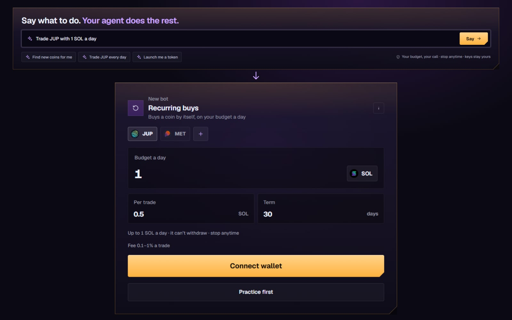

Type what you want in the line at the top of every screen — *“trade JUP every day”*, *“launch me a token”* — or press
**Ctrl K**. A model reads the sentence and the engine checks what it read; the
answer is one card with the coin, the amount a day and the limits filled in. What the card asks for, you fill; one
signature in your own wallet starts it.

- A trade becomes the agent's budget: a day's amount, a cap on each trade, a term and a strategy — steady buys, buys
  on dips, a buy grid — with an optional take-profit and stop. When your take-profit or your stop is reached, it stops
  buying; what it bought is already in your wallet, and you sell it with one signature. The agent selling on its own,
  without your signature, is coming.
- A launch opens the launch sheet with the name and ticker you said; a schedule becomes recurring buys.
- **Analyst** answers questions about any coin or the market — advice only, it moves nothing.

<b>In the code</b>

- The sentence read and checked: [`lib/sentence/plan.ts`](lib/sentence/plan.ts), [`lib/sentence/serve.ts`](lib/sentence/serve.ts)
- From the reading to a card: [`city/lib/command/plan.ts`](city/lib/command/plan.ts), [`city/lib/command/`](city/lib/command)
- The line on every screen: [`terminal/shell/AgentLine.tsx`](terminal/shell/AgentLine.tsx)
- The budget and its policy: [`lib/mandate/terms.ts`](lib/mandate/terms.ts), [`lib/mandate/ssa.ts`](lib/mandate/ssa.ts)
- Strategies, take-profit and stop: [`lib/mandate/strategy.ts`](lib/mandate/strategy.ts)
- The agent's round every five minutes and its daily report: [`lib/mandate/tick.server.ts`](lib/mandate/tick.server.ts), [`app/api/cron/agent-mandate/`](app/api/cron/agent-mandate), [`app/api/cron/agent-report/`](app/api/cron/agent-report)
- The Agents screen: [`terminal/agents/`](terminal/agents)

## Market

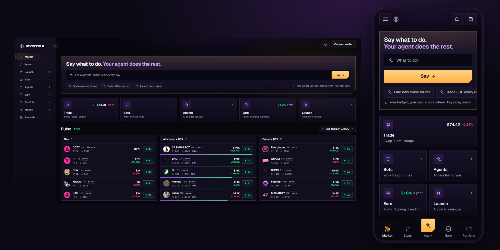

The home screen. **Pulse** shows coins as they launch, coins about to leave their bonding curve and coins that just
reached a DEX. Under it, every coin in one table — memes, crypto, tokenized stocks, pre-IPO — with price, volume,
market cap, liquidity, holders and a risk mark, filtered and sorted your way, and a buy in one tap.

<b>In the code</b>

- The screen: [`terminal/market/`](terminal/market) — `MarketScreen.tsx`, `Pulse.tsx`, `QuickBuy.tsx`
- The market's read: [`app/api/city/`](app/api/city), Pulse [`app/api/spot/pulse/`](app/api/spot/pulse), depth [`app/api/v1/market/`](app/api/v1/market)

## Spot

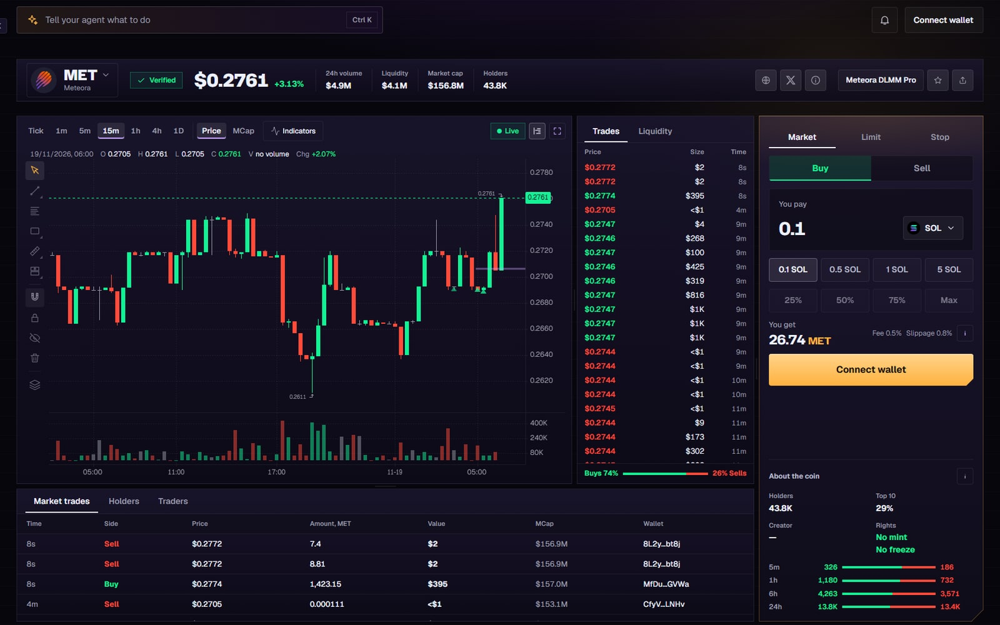

One coin: a live chart with drawing tools and indicators, the coin's trades, holders and traders, and one ticket for
**market**, **limit** and **stop** orders. Where the coin has a Meteora pool, the pool's liquidity is drawn on the
chart; where it has a Meteora DLMM Pro pool, the Limit tab places a ladder of up to 25 prices with a maker bonus
([Earn](#earn), [METEORA.md](METEORA.md#dlmm-pro)). The fee is shown before you sign.

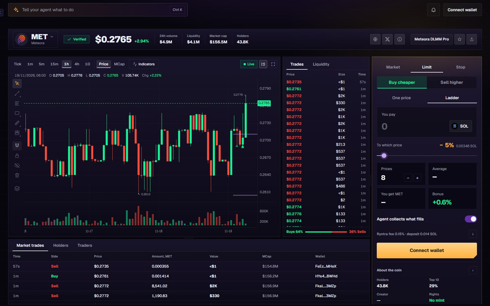

<b>In the code</b>

- The screen: [`terminal/coin/`](terminal/coin); the pool on the chart: [`terminal/coin/pool-layer.ts`](terminal/coin/pool-layer.ts); the ladder: [`terminal/coin/ladder/`](terminal/coin/ladder)
- The chart engine: [`vendor/ryntra-core/`](vendor/ryntra-core); candles and the coin's facts: [`app/api/spot/`](app/api/spot)
- Quotes and tickets: [`city/lib/trade/`](city/lib/trade); stops watched on the server: [`app/api/cron/spot-stops/`](app/api/cron/spot-stops)
- DLMM Pro limit orders: [`lib/pro-limits/`](lib/pro-limits), [`app/api/v1/ladders/`](app/api/v1/ladders)

## Swap and Bridge

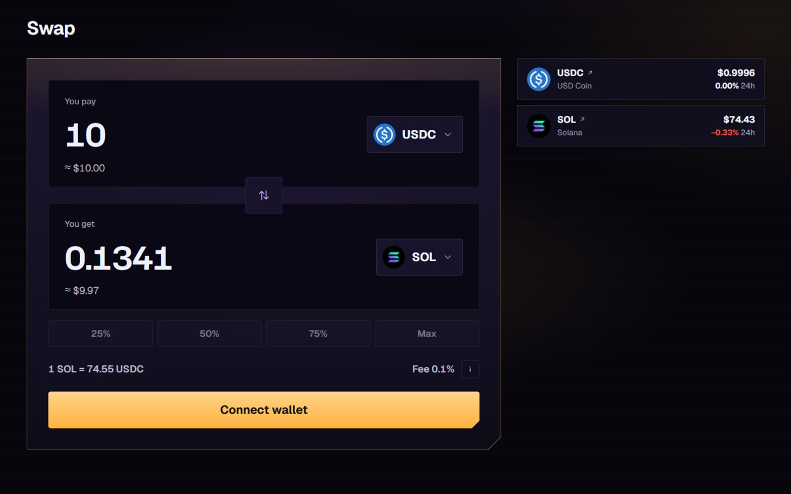

**Swap** — any coin for any coin on Solana, routed through Jupiter, the rate and the fee shown before you sign.
**Bridge** — dollars and coins between Solana and other chains through Relay, from the same Trade group.

<b>In the code</b>

- The screens: [`terminal/swap/`](terminal/swap) — `SwapScreen.tsx`, `BridgeScreen.tsx`
- Jupiter: [`lib/core/venues/jupiter.ts`](lib/core/venues/jupiter.ts), [`city/lib/trade/`](city/lib/trade)
- Relay: [`city/lib/money/bridge.ts`](city/lib/money/bridge.ts), [`app/api/swap/bridge/`](app/api/swap/bridge)

## Earn

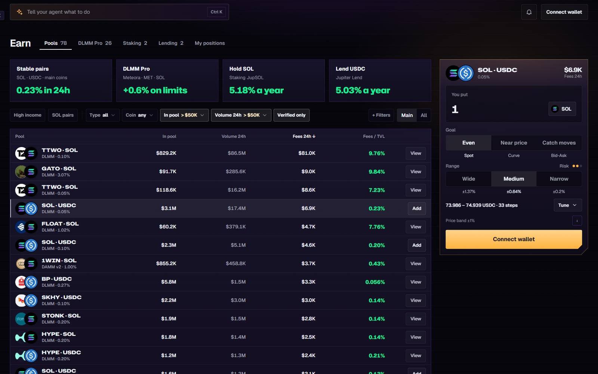

Put SOL or dollars to work in one signature: **Meteora pools** (DLMM, DAMM v2 and DLMM Pro), **staked SOL**, or
**lending** on Jupiter Lend. In a pool you pick a goal — Even, Near the price, Catch moves — and a width; the engine
builds the shape (Spot, Curve or Bid-Ask) and the bins, and the position stays in your wallet. On a DLMM Pro pool you
can pay with SOL alone: the part the shape needs of the other coin is swapped in the same pool, and the position opens
in the same approval.

On a DLMM Pro pool you can also paint the shape yourself — 32 columns, 16 each side of the price, starting from a ready
shape — and save it as yours.

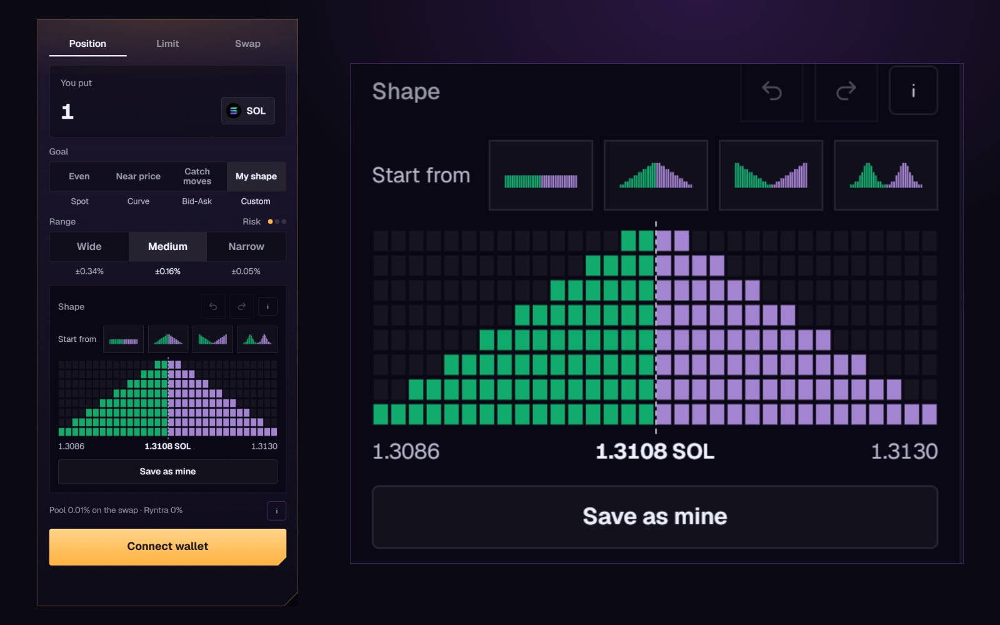

**DLMM Pro** has its own list: every Meteora DLMM Pro pool on Solana — the deepest of verified coins on top, then the ones waiting for a first position — and a page for each — the chart,
the pool's liquidity by price around the pool price, its book read from the bins, the fee, the limit bonus, and the
Limit ticket. Every Meteora DLMM pool opens on the same page.

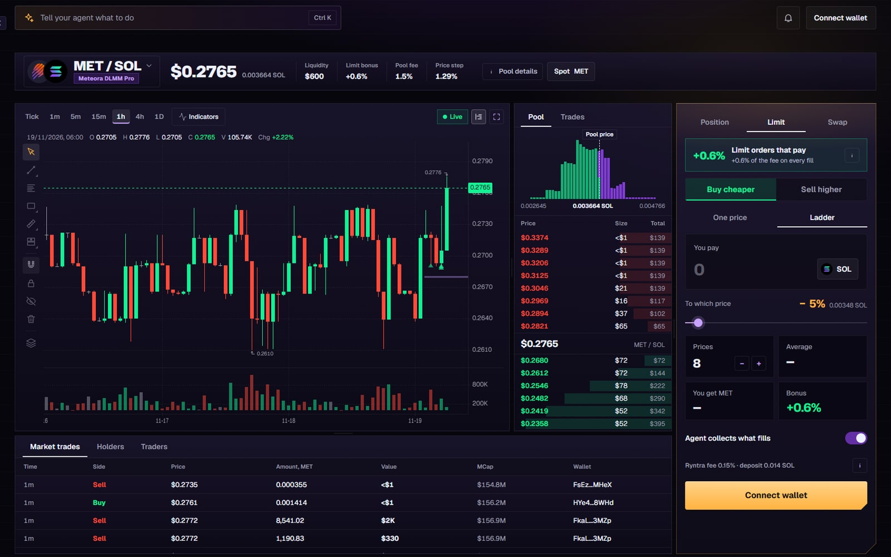

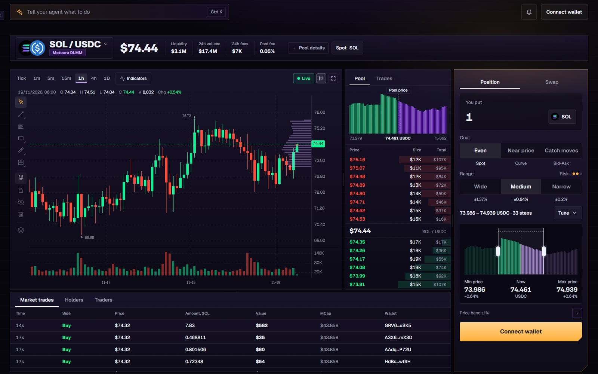

<b>In the code</b>

- The screen: [`terminal/earn/`](terminal/earn) — `PoolTicket.tsx`, `ProTicket.tsx`, the range editor [`terminal/earn/range/`](terminal/earn/range), the shape painter [`terminal/earn/shape/`](terminal/earn/shape)
- Meteora DLMM and DAMM v2: [`lib/liquidity/`](lib/liquidity), [`app/api/v1/earn/`](app/api/v1/earn)
- Meteora DLMM Pro: the list and each pool's page [`terminal/pool/`](terminal/pool), [`app/api/pro/pools/`](app/api/pro/pools); [`lib/earn-pro/`](lib/earn-pro), [`lib/core/venues/meteora-dlmm-pro/`](lib/core/venues/meteora-dlmm-pro), [`app/api/v1/earn/pro/`](app/api/v1/earn/pro)
- A keeper for a position: [`lib/care/`](lib/care) — see [METEORA.md](METEORA.md#an-agent-looks-after-a-position)

## Bots

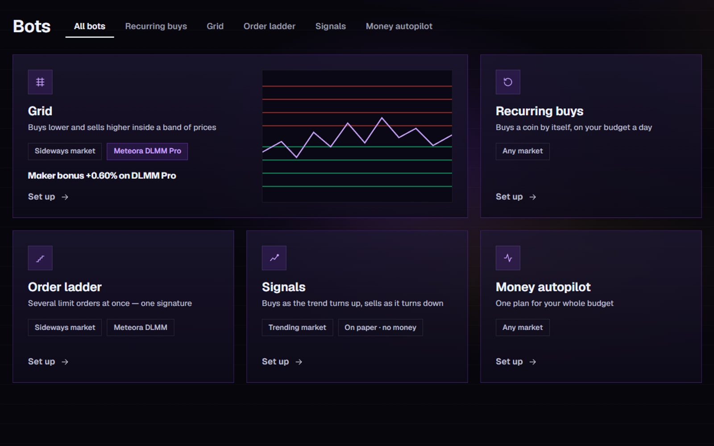

Rules that keep working after one approval:

- **Recurring buys** — buys a coin by itself on a budget a day, inside a Squads policy you sign once; you can practise
  on paper first.
- **Grid** — buys each step down and sells each step up between a low and a high price, both sides in one approval: on
  Meteora DLMM Pro limit orders where the coin has a DLMM Pro pool (with a maker bonus — MET first), on Meteora DLMM
  where it does not.

  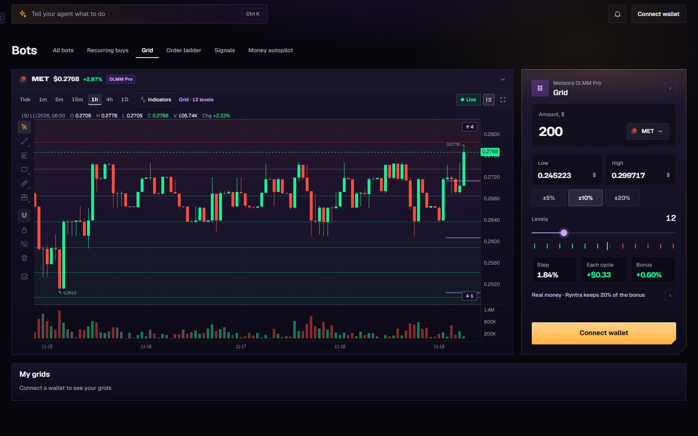

- **Order ladder** — several limit orders at once on a coin's Meteora DLMM pool, one signature.
- **Money autopilot** — one plan for your whole budget: a part for the agent to trade, a part saved in Jupiter Lend, a
  part in a Meteora pool, and a reserve that stays in your wallet.
- **Signals** — follows a fast and a slow average of the price; on paper, with no money and no signature.

<b>In the code</b>

- The screens: [`terminal/bots/`](terminal/bots)
- Recurring buys: [`lib/mandate/`](lib/mandate); the grid: [`lib/grid/`](lib/grid) on [`lib/pro-limits/`](lib/pro-limits);
  the ladder: [`lib/bots/ladder/`](lib/bots/ladder); the autopilot's plan: [`lib/pilot/`](lib/pilot)

## Launch

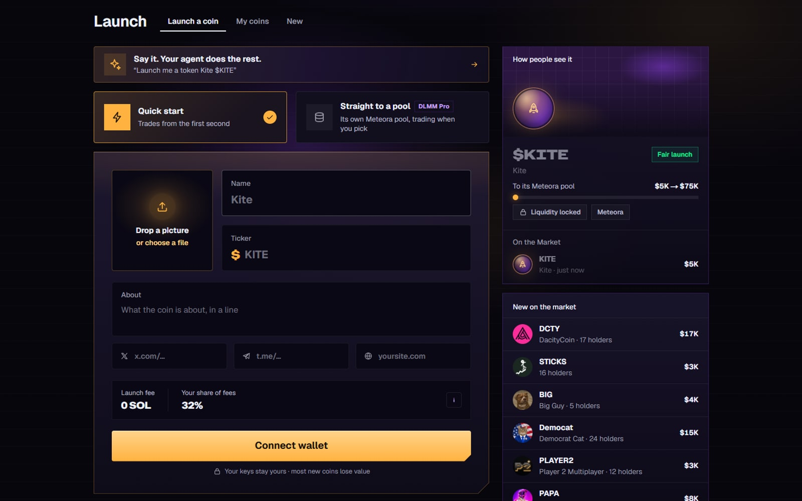

Name, ticker, picture, one signature. Two ways to start:

- **Quick start** — trades from the first second: the coin starts on a Meteora Dynamic Bonding Curve with a fee against snipers, and at about $75K it moves
  into a Meteora DAMM v2 pool by itself, its liquidity locked for ever.
- **Straight to a pool** — no curve: the coin trades in its own Meteora DLMM Pro pool from the time you pick; the fee
  against snipers falls as the market cap grows, and the supply goes in as liquidity nobody can take out. Three
  approvals: the coin, the pool, the supply.

The mint and freeze rights are given up at creation, and the creator's share of the fees is claimed in one signature
from **My coins**.

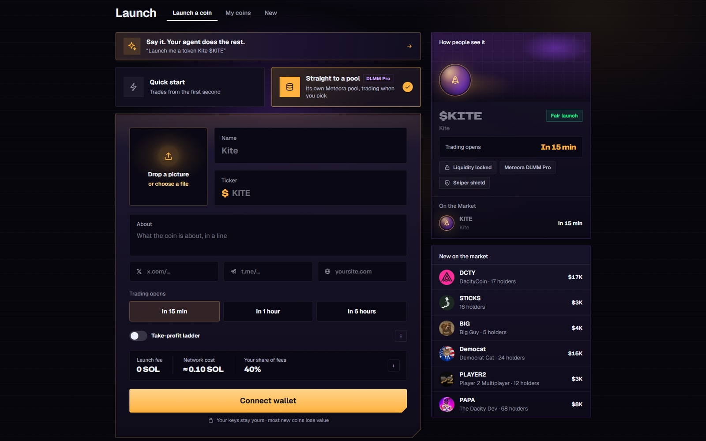

<b>In the code</b>

- The screen: [`terminal/launch/`](terminal/launch); the sheet's logic: [`city/lib/launch/`](city/lib/launch)
- On the curve: [`lib/core/venues/meteora-dbc/`](lib/core/venues/meteora-dbc), [`lib/launch/`](lib/launch), [`app/api/v1/launch/`](app/api/v1/launch)
- Into a pool: [`lib/launch-pool/`](lib/launch-pool), [`app/api/v1/launch/dlmm-pro/`](app/api/v1/launch/dlmm-pro)

## Portfolio

Everything a wallet holds across Solana in one place — coins, pools, staking, deposits and loans — for your own wallet
or any address you paste. **Collect fees** gathers what your positions earned, **Exit everything** takes them all
back to your wallet, and **Clean wallet** closes empty accounts and returns their rent.

<b>In the code</b>

- The screen: [`terminal/portfolio/`](terminal/portfolio)
- The read: [`lib/portfolio/`](lib/portfolio), [`app/api/v1/portfolio/`](app/api/v1/portfolio); the wallet's clean-up: [`app/api/v1/wallet/clean/`](app/api/v1/wallet/clean)

## Money and Rewards

**Money** — send to a wallet, receive at your address or its QR, and ask for an exact amount with a payment link
anyone can pay from any Solana wallet; Ryntra takes nothing and never holds the money. **Rewards** — points and
invites; a partner programme with a share of Ryntra's fee is coming.

<b>In the code</b>

- [`terminal/money/`](terminal/money), [`lib/pay/`](lib/pay), [`app/api/v1/pay/`](app/api/v1/pay)
- [`terminal/rewards/`](terminal/rewards), [`lib/rewards/`](lib/rewards)

## On your phone

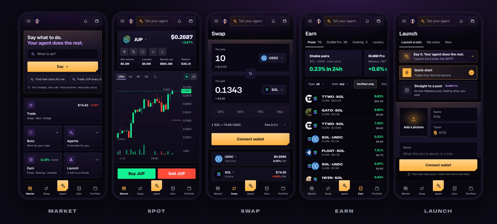

The same terminal at any phone's width: five tabs — Market · Swap · Agent · Earn · Portfolio — with the agent in the
middle, and every screen in a sheet. The Android app in the Solana dApp Store opens it full screen and signs through
Mobile Wallet Adapter — Phantom, Solflare or the Seeker's own wallet.

<b>In the code</b>

- The phone's frame: [`terminal/shell/PhoneBar.tsx`](terminal/shell/PhoneBar.tsx), [`terminal/shell/SectionsSheet.tsx`](terminal/shell/SectionsSheet.tsx)
- The Android app: [`apps/mobile/`](apps/mobile)

## Under the hood

Your keys stay with you: every transaction of yours is shown and signed in your own wallet. The agent signs its trades
with its own key — Ryntra's, held in Google Cloud KMS — only inside limits that live on-chain, and one signature of
yours stops it.

- **Unsigned by default.** The engine builds every transaction of yours unsigned, with the fee in it, and your wallet
  is the only signer.
- **The chain holds the budget.** A Squads smart account holds the agent's day, its cap on a trade and its venues, and
  what it buys can only arrive in your own wallet.
- **Read before the key signs.** The agent's trade is read the way the Squads program will read it; one the chain would
  refuse is not sent ([`lib/mandate/judge.ts`](lib/mandate/judge.ts)).
- **Checked before you sign.** Anyone can check a transaction or a payment link: the engine simulates the exact bytes
  and says what they would move ([`lib/ward/`](lib/ward), [`app/api/v1/ward/`](app/api/v1/ward)).

## Honest notes

- Coming: the agent selling on its own, without your signature; an AI trader that picks coins; futures on Phoenix in
  the terminal.
- Nothing here promises a profit. Fees, the minimum and the risk are shown before every signature; most new coins lose
  value.
