<!-- Generated by `node scripts/learn/build.mjs` from docs/learn/en/ (CITY-202). Do not edit here. -->

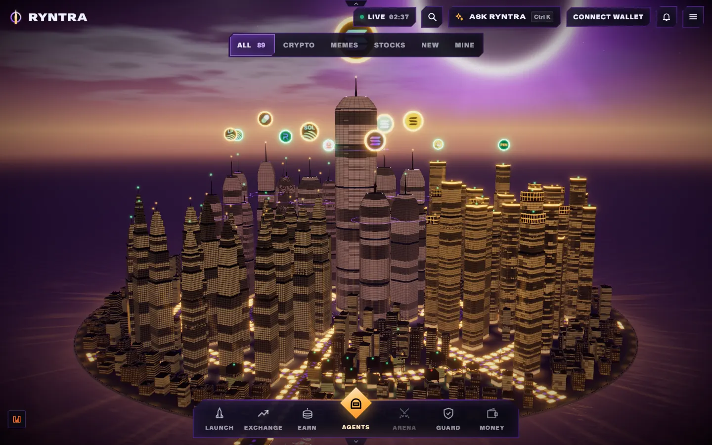
# Ryntra from A to Z

## In plain words

Ryntra is your AI agent on Solana. You say what you want — *“launch my coin”*, *“trade BONK for 0.1 SOL a day”* —
sign one budget in your wallet, and the agent does the rest. The whole market is a live 3D city where every coin is a
tower and yours grows in real time. Your money and keys always stay in your own wallet.

This guide walks through every part of Ryntra, one chapter each: what it is in plain words, what you press, a picture
of how it fits together, and — for the curious — which code does it.

## How the parts connect

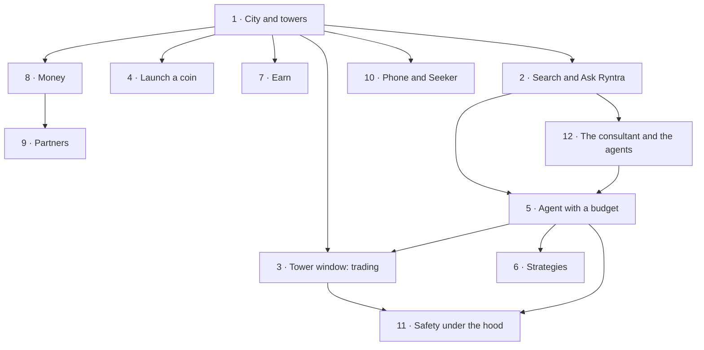

## Honest notes

- Nothing here promises profit. What is still being built is marked **coming**.
- Numbers (fees, limits) come straight from the engine's code; if they change there, this guide changes.

 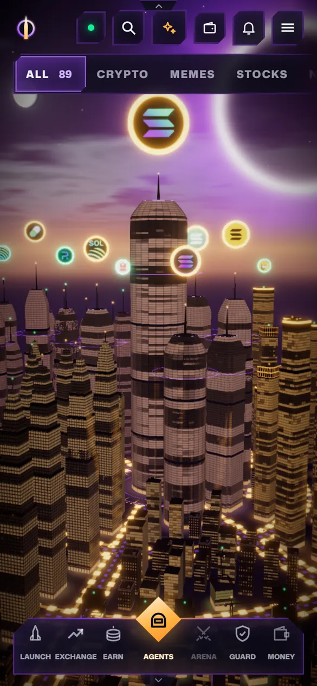
## Chapter 1: The city and its towers

### In plain words

Imagine the whole Solana market as a city seen from a helicopter at night. Every coin is a building. A big coin
is a tall skyscraper; a tiny new coin is a small house down by the docks. When many people trade a coin, its windows
light up. When the price went up today, the roof glows green; when it fell, red.

You do not need to read a single chart to know what is going on: you look at the skyline.

### Your steps

1. Open **ryntra.io**. The city loads by itself, no sign-up.
2. Pick a filter on top: **All · Crypto · Memes · Stocks · New · Mine**.
3. Drag to turn the city, pinch or scroll to zoom.
4. Tap any tower. Its window opens (chapter 3).

### How it fits together

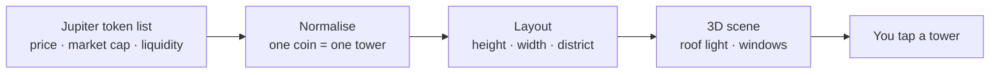

### Under the hood

- The city page is the site's home `/`: [app/(home)/page.tsx](<app/(home)/page.tsx>) renders `CityApp`
  from [city/components/CityApp.tsx](city/components/CityApp.tsx).
- Market data comes from Jupiter's token API: `readCity` in [city/lib/market/jupiter.ts](city/lib/market/jupiter.ts),
  served live by [app/api/city/route.ts](app/api/city/route.ts).
- `buildTowers` in [city/lib/market/normalize.ts](city/lib/market/normalize.ts) turns each coin into a tower and
  picks its district: **core** (SOL and the big coins), **heights** (DeFi), **strip** (memes), **avenue** (stocks and gold),
  **docks** (new pools). SOL stands in the middle as the spire.
- `towerHeight` in [city/lib/city/layout.ts](city/lib/city/layout.ts): height follows market cap on a log scale,
  but never more than the coin's liquidity allows, so a coin with a big "paper" value and little real money stays short.
- [city/components/city/Towers.tsx](city/components/city/Towers.tsx): the roof turns mint at +5 % a day or more,
  red at −5 % or less, amber in between; window activity follows the number of traders in the last hour.
- The camera and its gentle idle orbit live in [city/components/city/CameraRig.tsx](city/components/city/CameraRig.tsx).

### Honest notes

- The pictures in this guide are real frames of ryntra.io, not drawings.
- Towers show the market; a tall tower is not advice to buy it.

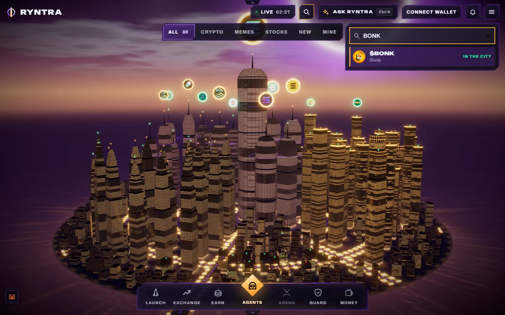 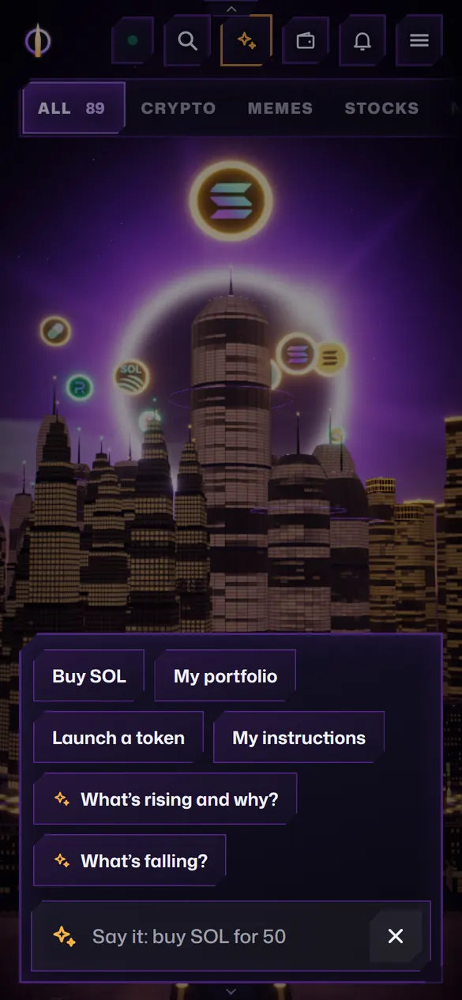
## Chapter 2: Search and “Ask Ryntra”

### In plain words

Search is the city's map: type “BONK” and the camera flies to its tower. **Ask Ryntra** is a friendly guide standing
next to you: you ask “what's rising and why?”, it looks at the market, answers in a few lines and lights up the towers
it talks about. The guide explains; it never spends your money.

### Your steps

1. Tap the **magnifier** and type a ticker, a name or a coin address. Pick a result; the tower window opens.
2. Or tap **Ask Ryntra** (on a computer: **Ctrl K**). Choose a ready question — *Buy SOL · My portfolio · Launch a token ·
   What's rising and why?* — or type your own.
3. Read the short answer. The towers in the answer glow; tap one to open it.
4. Say what you want done — *“buy SOL for 50”* — and Ryntra prepares it for you to confirm (chapters 3 and 5).

### How it fits together

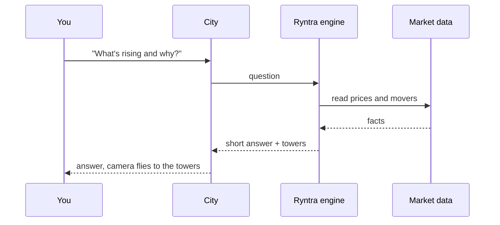

### Under the hood

- Search box: [city/components/search/CitySearch.tsx](city/components/search/CitySearch.tsx). Results are ranked
  by `cityHits`, `launchHits`, `catalogHits` and merged by `mergeHits` (8 best) in
  [city/lib/search/rank.ts](city/lib/search/rank.ts); sources are in
  [city/lib/search/sources.ts](city/lib/search/sources.ts).
- Ask Ryntra: [city/components/assistant/AssistantLayer.tsx](city/components/assistant/AssistantLayer.tsx) sends the
  question with `askGuest` ([city/lib/assistant/ask.ts](city/lib/assistant/ask.ts)) to
  [app/api/v1/assistant/guest/route.ts](app/api/v1/assistant/guest/route.ts). The server answers with read-only
  market tools from [lib/assistant/guest.ts](lib/assistant/guest.ts).
- `pickTowers` in [city/lib/assistant/answer.ts](city/lib/assistant/answer.ts) chooses which towers to light.
- The command line that understands “buy SOL for 50” or “trade for me” is `readAsk` in
  [city/lib/autopilot/read.ts](city/lib/autopilot/read.ts).

### Honest notes

- Answers are information, not financial advice. Ryntra's guide has no tool that signs or sends money.
- A few questions a minute per visitor; when the guide is busy, the city shows its own market read instead.

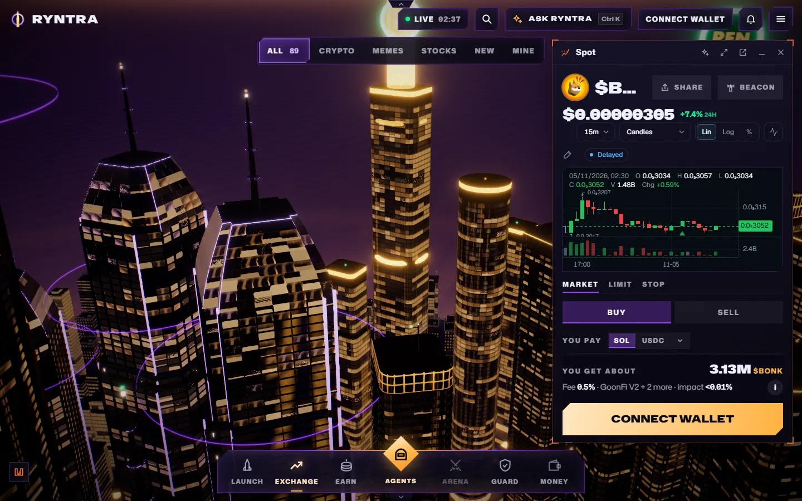 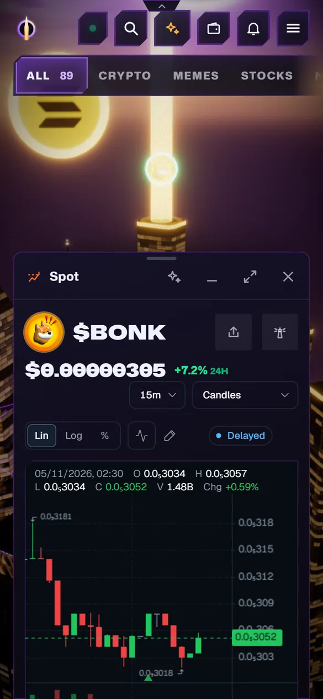
## Chapter 3: The tower window: trading

### In plain words

A tower is also a shop. You walk in (tap it), see the price on the board, say how much you want and pay at the till
(your wallet). Ryntra finds the cheapest way to make the swap through **Jupiter**, Solana's biggest swap router, and
shows you the result and the fee before you agree. You sign once; the coins land in your own wallet.

### Your steps

1. Tap a tower (or find it in search).
2. Choose **Market**, **Limit** or **Stop**, then **Buy** or **Sell**, and type how much you pay.
3. Check *“you get about …”* and the fee, then **Confirm** in your wallet (the first time, **Connect wallet**).
4. A limit order (“buy if the price drops to …”) waits in **My orders** until it fills or you cancel it.

### How it fits together

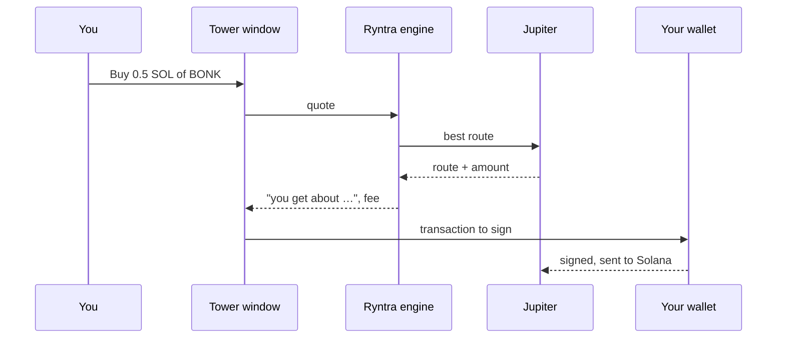

### The fee, in one line

| Coin type | Ryntra fee per trade |
|---|---|
| Memes and very new coins | 1 % |
| Trending, verified coins | 0.5 % |
| Tokenised stocks | 0.25 % |
| Big coins (SOL, BTC, ETH…) | 0.1 % |
| Stablecoins | 0 |

### Under the hood

- Window and ticket: [city/components/trade/TradeSheet.tsx](city/components/trade/TradeSheet.tsx),
  [city/components/trade/SpotTicket.tsx](city/components/trade/SpotTicket.tsx), orders in
  [city/components/trade/MyOrders.tsx](city/components/trade/MyOrders.tsx).
- `createEngine` in [city/lib/trade/engine.ts](city/lib/trade/engine.ts) calls `/api/solana/swap/quote`, `order`
  and `execute`; the server prepares the swap in `prepareSolanaSwap`
  ([lib/core/solana-swap/prepare.ts](lib/core/solana-swap/prepare.ts)).
- The fee table lives in exactly one place: `FEE_POLICY_V2` in [lib/core/fee-policy.ts](lib/core/fee-policy.ts).
  A verified coin counts as *trending* once its first pool is 7 days old; younger or unverified coins count as memes.
- Limit orders go through Jupiter Trigger: `reviewLimit`, `placeLimit`, `cancelLimit` in
  [city/lib/trade/limits.ts](city/lib/trade/limits.ts); the smallest order is $5.
- Before you sign, the engine simulates the swap and refuses it if you would receive less than promised
  (`assessSwapSimulationEffects`, [lib/solana/swap-effect-firewall.ts](lib/solana/swap-effect-firewall.ts)).

### Honest notes

- Prices move. The amount shown is an estimate inside a small slippage limit; the coin can be worth less tomorrow.

 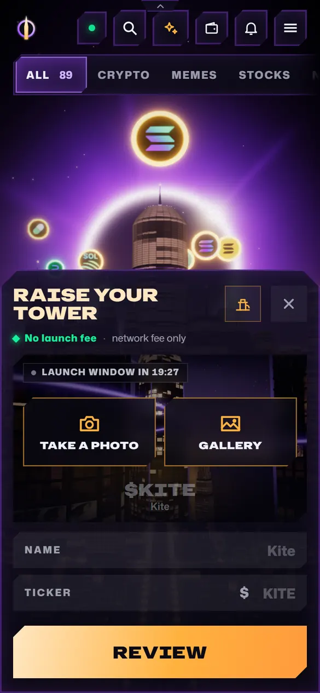
## Chapter 4: Launching a coin

### In plain words

Think of a new coin as a lemonade stand that starts on a **ramp**. At first the price is set by a simple rule: each
buyer pushes the price a little higher up the ramp (the **bonding curve**, Meteora DBC). When enough people have bought
— about **$75,000** of market value — the stand “graduates”: it moves into a real market pool (**Meteora DAMM v2**),
where its starting money is locked for ever so nobody can pull the rug. After that, Ryntra can add a ladder of buy
orders under the price (**Meteora DLMM**). In the city you watch your tower rise the whole way.

### Your steps

1. Open **Launch** in the bottom bar (“Raise your tower”).
2. Add a **picture** (take a photo or pick one), a **name** and a **ticker**.
3. Press **Review** and choose bot protection: **Protected** (default) or **Classic**.
4. Read *Before you sign* and press **Launch** — one signature. Your tower appears; share the link.

### How it fits together

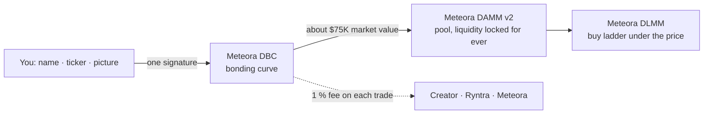

### Who earns what

- **No launch fee** — you pay only the Solana network fee.
- Each trade on the curve pays **1 %**. In the first minutes bots pay much more (an anti-sniper fee that falls to 1 %:
  over 10 minutes on *Protected*, 2 minutes on *Classic*).
- That 1 % is split: **creator 32 %**, **Ryntra 48 %**, **Meteora 20 %** (the creator gets 40 % of what is left after
  Meteora's part).

### Under the hood

- Launch sheet: [city/components/launch/LaunchSheet.tsx](city/components/launch/LaunchSheet.tsx); the whole flow is
  `runLaunch` in [city/lib/launch/flow.ts](city/lib/launch/flow.ts), which calls `/api/v1/launch/build` and `/submit`
  through `httpEngine` ([city/lib/launch/engine.ts](city/lib/launch/engine.ts)).
- Curve presets (start, graduation at $75K, fees, anti-sniper): `LAUNCH_PRESETS` in
  [lib/core/venues/meteora-dbc/presets.ts](lib/core/venues/meteora-dbc/presets.ts).
- Graduation rules (DBC → DAMM v2, liquidity locked): [lib/core/launch/constitution.ts](lib/core/launch/constitution.ts).
- Buy ladder after graduation: [lib/core/venues/meteora-dlmm/floor.server.ts](lib/core/venues/meteora-dlmm/floor.server.ts).
- Who gets which share: [lib/core/launch/revenue-rule.ts](lib/core/launch/revenue-rule.ts).
- New coins have 1 billion tokens (Token-2022) and trade against USDC.

### Honest notes

- Most new coins never graduate. A launch is a start, not a promise of value.
- The creator's fees are claimed with one signature from the coin's window.

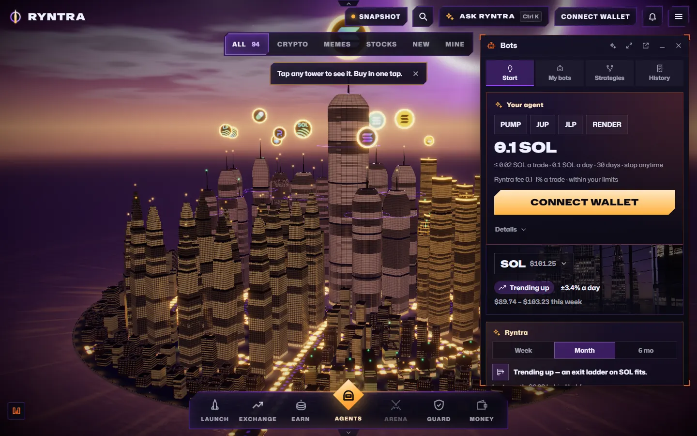 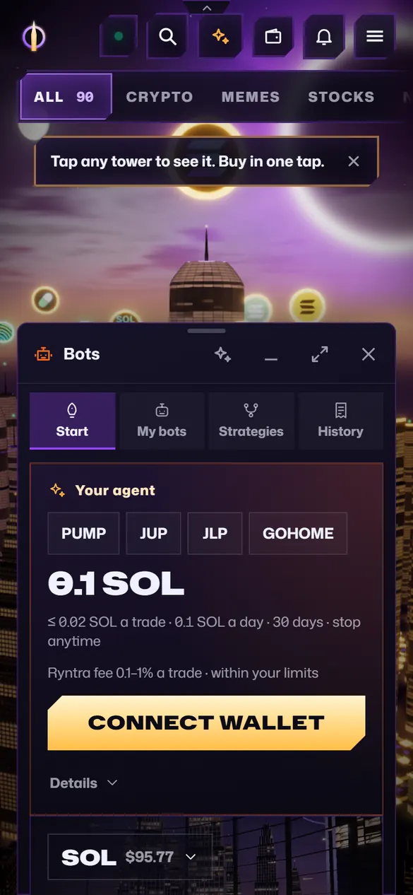
## Chapter 5: Your agent with a budget

### In plain words

Imagine giving a helper a **prepaid card** with a daily limit, a list of shops where it works, and a rule that
everything bought goes straight to your home. The helper can shop for you every day, but it can never spend more than
the card allows, never shop elsewhere and never keep anything. And you can cut the card in half at any moment.

That is Ryntra's agent. The “card” is a **Squads Smart Account** on Solana with a spending policy. The limits are kept
by the blockchain itself, not by a promise in our code.

### Your steps

1. Open **Agents → Bots → Start** (“Your agent”), or just say it: *“trade for me”*.
2. Pick a coin and look at the plan; try it **on history** or **practise** without money first (chapter 6).
3. Check the limits — *≤ 0.02 SOL a trade · 0.1 SOL a day · 30 days* — and **Sign** once in your wallet.
4. Every evening you get a short report; **Stop** anytime with one signature, and the rest comes back.

### How it fits together

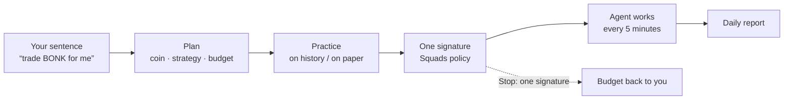

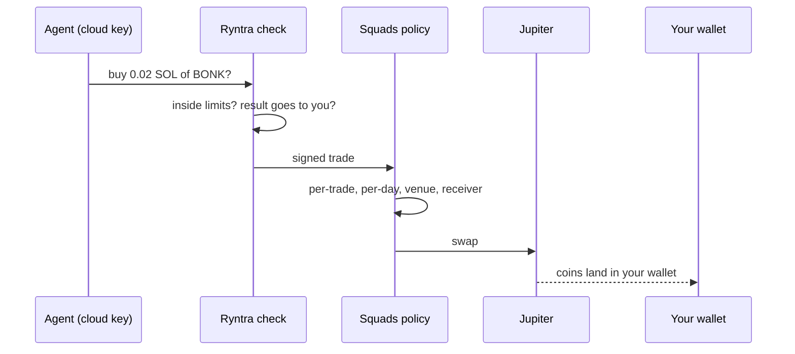

### The limits, today on mainnet

- Budget **0.1 SOL a day**, at most **0.02 SOL a trade**, for **30 days**.
- Only Jupiter routes are allowed; slippage at most 1 %.
- Coins can only arrive in **your** wallet.
- **Autostop**: the agent pauses after a 15 % loss in total, three losing buys in a row or three failed trades in a row.
- Ryntra's fee is the normal trade fee from chapter 3 (0.1–1 % a trade), inside your limits.

### Under the hood

- Budget card: [city/components/bots/AgentBudget.tsx](city/components/bots/AgentBudget.tsx); sentence → plan:
  `readAsk` in [city/lib/autopilot/read.ts](city/lib/autopilot/read.ts) and
  [city/lib/autopilot/plan.ts](city/lib/autopilot/plan.ts).
- Budgets: `BUDGET_PRESETS` in [lib/mandate/presets.ts](lib/mandate/presets.ts); the policy itself (venues,
  per-trade, per-day, slippage, receiver, expiry) is built in [lib/mandate/terms.ts](lib/mandate/terms.ts) and
  written as Squads Smart Account instructions in [lib/mandate/ssa.ts](lib/mandate/ssa.ts).
- Signing up and stopping: `reviewEnable`, `reviewStop`, `relayMandate` in
  [lib/mandate/service.server.ts](lib/mandate/service.server.ts), routes under `app/api/bots/mandate/`.
- The agent's turn: a cron every 5 minutes runs `runAgentPass`
  ([lib/mandate/tick.server.ts](lib/mandate/tick.server.ts)); the strategy decides, the trade is checked, then
  signed by a key that lives in Google Cloud KMS (`kmsKeySigner`,
  [lib/launch/signer/gcp-kms.server.ts](lib/launch/signer/gcp-kms.server.ts)). The agent never sees your key.
- Every agent swap carries an extra instruction: *“if the coins did not arrive in your account, cancel the whole trade”*
  (`receivedAtLeastInstruction`, [lib/mandate/result.ts](lib/mandate/result.ts)).
- Autostop rules: `autostop` in [lib/mandate/strategy.ts](lib/mandate/strategy.ts).
- Daily report: hourly cron, sent at your evening hour by `runAgentReport`
  ([city/lib/autopilot/report-watch.server.ts](city/lib/autopilot/report-watch.server.ts)).

### Honest notes

- Selling by the agent itself is **coming**. Today, when a strategy says “take profit”, the agent stops buying and you
  sell in one tap from its card.
- Bigger budgets are coming; they open step by step.
- An agent can lose money. Start small; the limits are there so a mistake stays small.

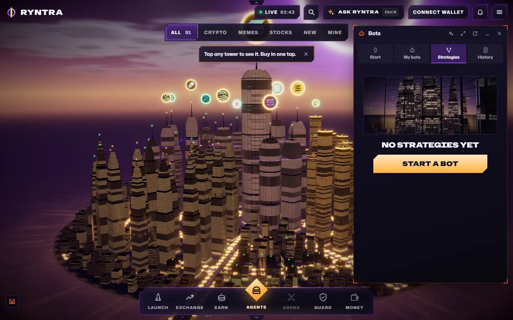 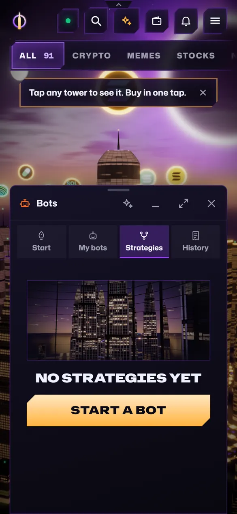
## Chapter 6: Strategies

### In plain words

A strategy is the agent's recipe. You do not need to invent one: Ryntra has a short cookbook of simple recipes that
traders have used for years. You choose the recipe in plain words, the agent follows it exactly — no mood, no guessing.
Before cooking for real, you can see how the recipe would have done **on history**, and then **practise** with pretend
money.

| Recipe | What it does, like you are 12 |
|---|---|
| **Regular buys** | Buy a little every day, whatever the price. Like saving pocket money weekly. |
| **Buy the dip** | Buy only when the price has fallen by X %. Like waiting for a sale. |
| **Grid** | Place steps of buys below the price, X % apart. Like a ladder that catches falls. |
| **New launches that pass the check** | Enter fresh coins only if they pass a safety filter. |

Each recipe can have a **take-profit** (“sell when up X %”) and a **stop** (“get out when down X %”).

### Your steps

1. In **Agents → Bots**, pick a coin; Ryntra suggests a fitting plan (for example *“trending up — an exit ladder fits”*).
2. Press **On history** to see a picture of the last days. It is a picture, not a promise.
3. Press **Practice first** to run the plan with no money.
4. When you are ready, **Go live · sign once** — or **End practice**.

### How it fits together

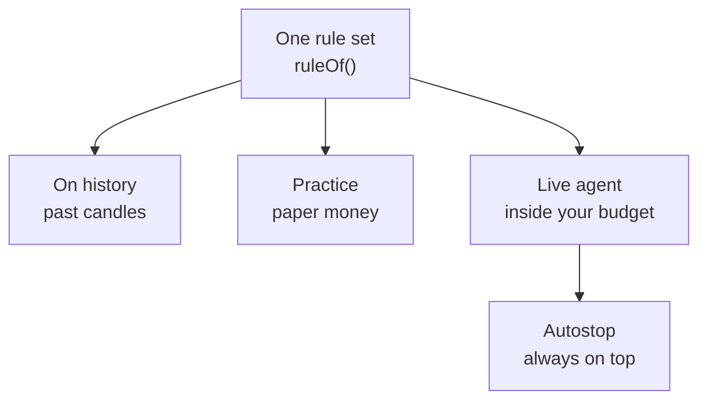

### Under the hood

- The recipes and their bounds: `PLAN_IDS` (steady · dip · grid · early), `planFrom`, `ruleOf` in
  [lib/mandate/plans.ts](lib/mandate/plans.ts). Dip 3–50 %, grid steps 2–20 % with 2–10 levels, stop 3–15 %
  (never looser than the autostop), 1–24 buys a day.
- The decision at trade time: `decide` in [lib/mandate/strategy.ts](lib/mandate/strategy.ts). No AI model is
  asked at that moment; the rule decides. A strategy only decides *whether now*; it can never raise the size, the
  limits or change the venue.
- History and practice: `runPlan` and `paperRun` in [lib/mandate/backtest.ts](lib/mandate/backtest.ts), behind
  `/api/bots/mandate/test`. The history run counts fees, slippage and network costs.
- The early-launch filter (`earlyRefusal`): at least $10K liquidity, $20K market cap, 100 holders, top 10 holders
  ≤ 30 %, developer ≤ 10 %, and not a serial launcher.
- Labels in the city: [city/lib/autopilot/words.ts](city/lib/autopilot/words.ts).

### Honest notes

- Past results do not promise future ones.
- The arena where agents compete with real budgets and the best strategies become templates is **coming**.

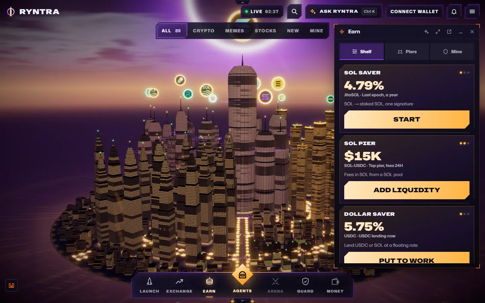 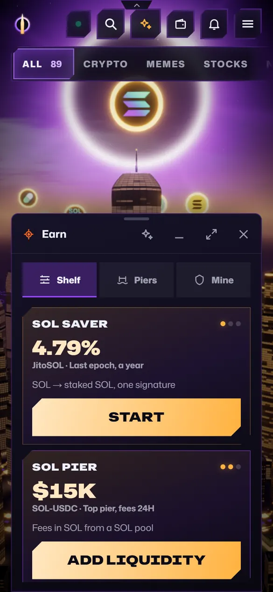
## Chapter 7: Earn — savers and piers

### In plain words

**A saver** is like a piggy bank at a bank that pays interest: you put in dollars (USDC) or SOL, others borrow them and
pay you a small rate. Ryntra uses **Jupiter Lend** for the **Dollar Saver**. The **SOL Saver** turns SOL into staked SOL
that grows a little every few days.

**A pier** is like owning a little stall in a busy market: you put two coins into a **Meteora** pool, and every time
someone swaps through the pool, you get a slice of the fee. With **one coin** you can still open a pier — Ryntra swaps
half for you in the same approval (Meteora **Zap**).

Your position always stays in **your** wallet; you can take it back anytime.

### Your steps

1. Open **Earn**. Tabs: **Shelf** (savers), **Piers**, **Mine**.
2. On a card, read the live rate and press **Start**, **Put to work** or **Add liquidity**.
3. Type an amount (for a pier, choose **calm**, **balanced** or **dense**) and approve once in your wallet.
4. In **Mine**, watch your positions and press **Take back** when you want.

### How it fits together

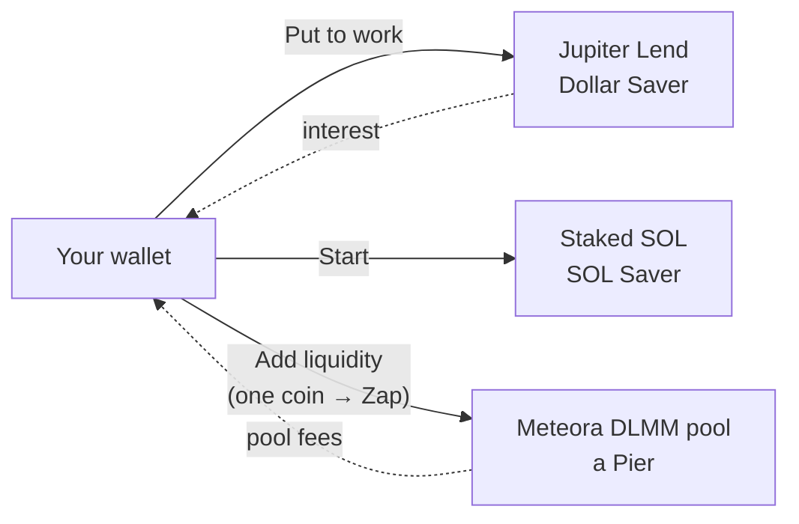

### Under the hood

- The window: [city/components/earn/EarnWindow.tsx](city/components/earn/EarnWindow.tsx), cards
  [Dollar.tsx](city/components/earn/Dollar.tsx), [Saver.tsx](city/components/earn/Saver.tsx),
  [Piers.tsx](city/components/earn/Piers.tsx).
- Dollar Saver: `jupiterLendAdapter` in [lib/earn/jupiter-adapter.ts](lib/earn/jupiter-adapter.ts); the server
  builds the deposit or withdrawal for your wallet (`app/api/solana/earn/review`, `/submit`) and checks the gates again
  before building and before sending (`admitEarn`, [lib/earn/gate.ts](lib/earn/gate.ts)).
- Piers: [city/lib/earn/pier.ts](city/lib/earn/pier.ts) (styles, slippage, minimum 0.05 SOL),
  [city/lib/earn/pier-gate.ts](city/lib/earn/pier-gate.ts) (who may add and how much).
- One-coin pier: `zap_in` in [lib/liquidity/studio/zap.ts](lib/liquidity/studio/zap.ts) — part of the SOL is
  swapped through Jupiter or the pool, whichever gives more, and the DLMM position opens; up to three transactions,
  one approval. If a zap lands only in part, **Take the rest** swaps the leftover back.

### What Ryntra takes

- Dollar Saver and pier positions: **0 %** from Ryntra.
- A swap step inside (SOL Saver, or the swap half of a Zap through Jupiter) pays the normal swap fee from chapter 3.

### Honest notes

- Rates change every minute; the number on the card is today's, not a promise.
- Pools can lose value against simply holding (when prices move apart). The pier card shows the range you chose.
- More savers (dollars under stocks, sell-higher / buy-lower orders) are **coming**.

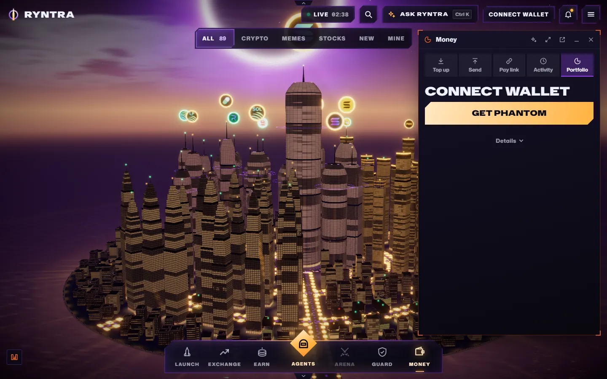 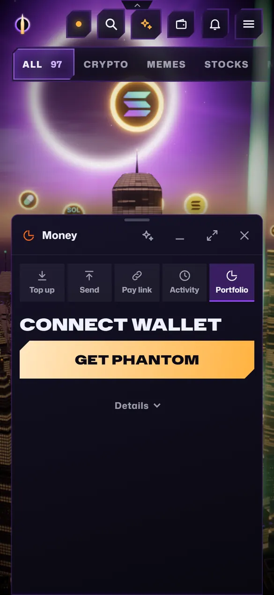
## Chapter 8: Money

### In plain words

Your crypto wallet (Phantom, Solflare, Backpack or the Seeker phone) is your **pocket**. Ryntra never takes the money
out of your pocket to keep it; it only shows you what is inside and prepares payments that **you** approve. The Money
window is like a banking app laid over that pocket.

### Your steps

1. Tap **Connect wallet** and pick your wallet — no sign-up, no e-mail. (No wallet yet? **Get Phantom**.)
2. **Top up**: copy your Solana address, or deposit from another network (Base, Ethereum, Arbitrum, Optimism, Polygon, BNB).
3. **Send**: type an address or a `.skr` name and the amount → **Review** → **Confirm in wallet**.
4. **Pay link**, **Activity** and **Portfolio**: ask someone to pay you, see what happened and what you own.

### How it fits together

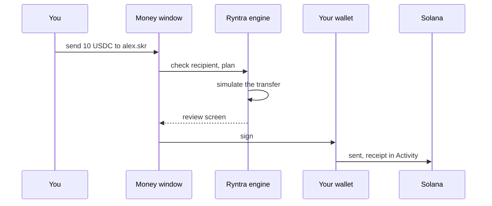

### Under the hood

- The window and tabs: [city/components/money/MoneyWindow.tsx](city/components/money/MoneyWindow.tsx), labels in
  [city/lib/money/words.ts](city/lib/money/words.ts).
- Wallets: `detectWallets`, `connectWallet` in [lib/solana/wallet.client.ts](lib/solana/wallet.client.ts) (Wallet
  Standard). Proving it is your wallet is one message you sign — no transaction: `proveWallet` in
  [city/lib/trade/proof.ts](city/lib/trade/proof.ts).
- Send: [city/lib/money/send.ts](city/lib/money/send.ts) → `/api/solana/transfer/plan`, `/settle`, `/recover`;
  the plan is simulated before you sign. If your wallet adds its own safety checks, the engine accepts them (`adopt`).
- Deposit from another network: [lib/relay/deposit-address.ts](lib/relay/deposit-address.ts) (from $1).
- Send to another network: [city/lib/money/bridge.ts](city/lib/money/bridge.ts) (USDC to an EVM address).

### Honest notes

- Top-up with a bank card is **coming**.
- Ryntra never asks for your secret phrase. Anyone who does is not Ryntra.

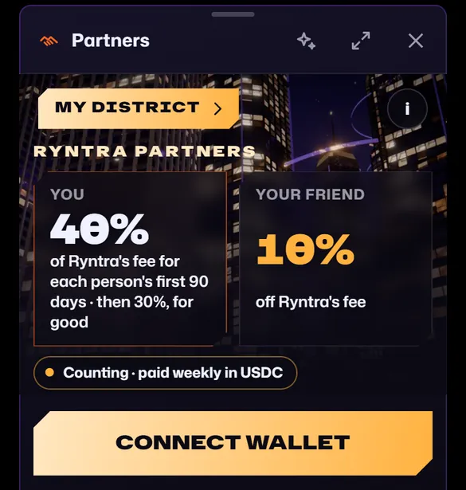
## Chapter 9: Partners and payouts

### In plain words

When you bring a friend to a café and the café thanks you with a share of what your friend spends, everybody wins:
your friend gets a discount, you get a thank-you, the café gets a new guest. Ryntra Partners works the same way,
counted automatically and paid every week.

### Your steps

1. Open **Menu → Partners** and connect your wallet.
2. **Copy my link** (it looks like `ryntra.io/r/<your code>`) and share it.
3. Your friend opens the link and trades, launches or swaps in the city.
4. Every week you receive your share in **USDC** to your wallet.

### The terms

- **You:** 40 % of Ryntra's fee from each invited person for their first 90 days, then 30 % for good.
- **Your friend:** 10 % off Ryntra's fee.
- Paid **weekly in USDC**; amounts under $5 roll over to the next week.
- One level only — no pyramids.

### How it fits together

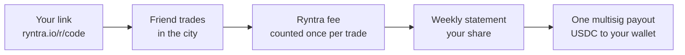

### Under the hood

- The window and the `/partners` page: [city/components/partners/PartnersWindow.tsx](city/components/partners/PartnersWindow.tsx),
  [city/components/partners/PartnersPage.tsx](city/components/partners/PartnersPage.tsx).
- The link only remembers who invited you: [app/r/[code]/route.ts](<app/r/[code]/route.ts>).
- The terms in one place: `PARTNER_TERMS` in [city/lib/partners/terms.ts](city/lib/partners/terms.ts).
- The weekly statement: `prepareStatement` in [lib/partner-payouts/week.ts](lib/partner-payouts/week.ts) — each
  fee-paying operation is credited exactly once, to the inviter recorded at that moment.
- The payout: `weeklyPass` in [lib/partner-payouts/payouts.server.ts](lib/partner-payouts/payouts.server.ts)
  turns the week into one Squads multisig proposal, signed by Ryntra's treasury; a cron prepares it
  (`app/api/cron/partner-payouts`). Referral abuse is filtered by [lib/growth/referral-guard.ts](lib/growth/referral-guard.ts).

### Honest notes

- What you earn depends only on what your friends really do; there is no promised amount.

 
## Chapter 10: Phone and Seeker

### In plain words

The phone app is a window onto the same city. Whatever you do on the computer, you can do on the phone, with big
buttons for your thumb. On a **Solana Seeker** phone, the wallet is built into the phone (Seed Vault), so signing is
one tap with your fingerprint.

### Your steps

1. Install **Ryntra** from the **Solana dApp Store** (or open ryntra.io in the phone browser).
2. Tap **Connect wallet**. The app opens your phone wallet through **Mobile Wallet Adapter**.
3. Use the city as usual. Every money action pops up your wallet to approve.
4. On Seeker your `.skr` name works in **Send** and in your profile.

### How it fits together

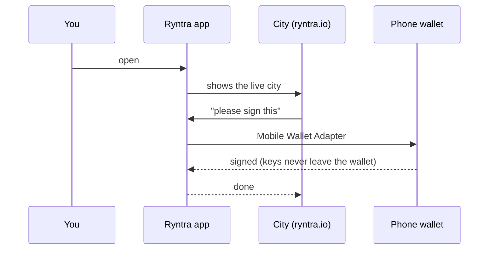

### Under the hood

- The Android app is an Expo app in `apps/mobile/` (package `io.ryntra.app`). Its one screen shows ryntra.io in a
  WebView: [apps/mobile/src/features/city/city-page.ts](apps/mobile/src/features/city/city-page.ts).
- The bridge between the page and the app (one wallet request at a time):
  [apps/mobile/src/features/city/bridge.ts](apps/mobile/src/features/city/bridge.ts) and, on the page side,
  [city/lib/app-bridge/](city/lib/app-bridge/).
- Wallet on the phone: [apps/mobile/src/features/wallet/use-wallet.ts](apps/mobile/src/features/wallet/use-wallet.ts)
  (Mobile Wallet Adapter). The app never holds keys.
- Seeker on the web: [lib/solana/seeker-connect.ts](lib/solana/seeker-connect.ts); Seeker sign-in and `.skr`:
  [apps/mobile/src/features/seeker/seeker-model.ts](apps/mobile/src/features/seeker/seeker-model.ts).

### Honest notes

- New app versions reach the dApp Store after review, so the store may be a version behind the website.

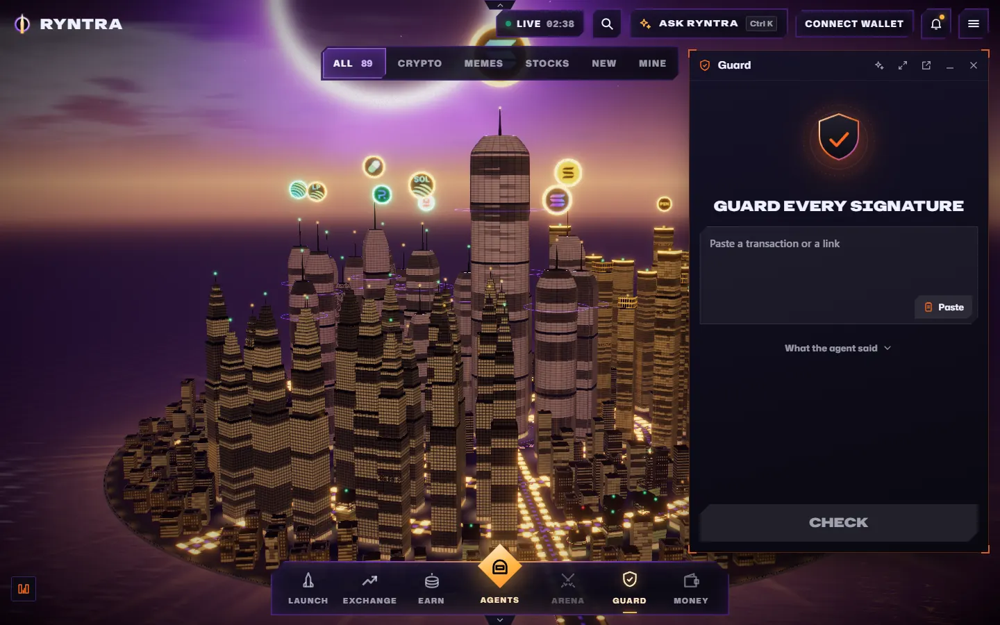 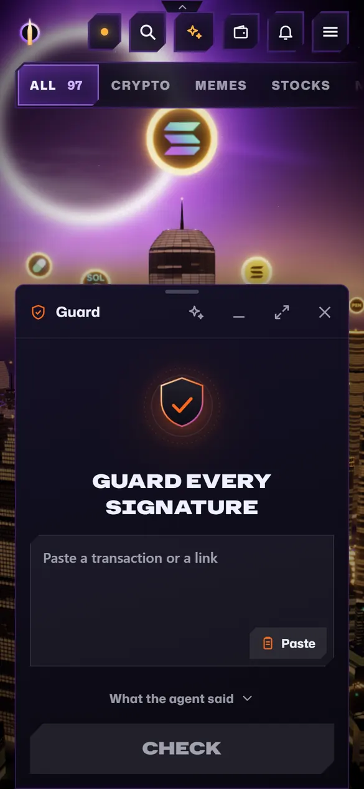
## Chapter 11: Safety, under the hood

### In plain words

You hold the keys to your own house. Ryntra is a helpful neighbour: it can carry your shopping to the door, but it has
no key, and the door itself (the blockchain) refuses anything you did not allow. You can see all of this in one line
on every screen: *you sign once, you can stop anytime, the keys stay with you.*

### Your steps

1. Read what you sign: the wallet shows every transaction before it goes.
2. Start the agent small; the limits are there so a mistake stays small.
3. Press **Stop** anytime — one signature, the rest comes back.
4. Not sure about a transaction or a link? Paste it into **Guard** and press **Check**.

### The rules, one by one

1. **Your keys stay in your wallet.** Ryntra never sees or stores them; every money action is a transaction you sign.
2. **The agent's limits live on the blockchain.** Per-trade and per-day limits, allowed venues and “coins go only to your
   wallet” are part of the Squads policy, so even a bug in our code cannot break them.
3. **The agent has its own key, with an expiry.** It lives in Google Cloud KMS and can only act inside your budget;
   its access ends with the budget's term (30 days today).
4. **Every transaction is checked before it is sent.** The engine simulates it and compares *what you get* with *what was
   promised*; if it does not match, it stops.
5. **“Money didn't reach you → the trade fails.”** Agent trades carry an on-chain check that cancels the trade if the coins
   did not land in your account.
6. **Autostop and stop.** The agent pauses itself after losses; you can stop it with one signature at any time.
7. **Coin names are data, not commands.** Text from coin names, descriptions or messages is cleaned and never followed as
   an instruction by the AI.
8. **Guard.** Paste any transaction or link into the **Guard** window and press **Check** to see what it would really do.

### How it fits together

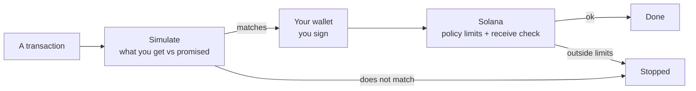

### Under the hood

- Pre-send check (Guard): `checkWard` in [lib/ward/check.ts](lib/ward/check.ts) — the bytes, a simulation
  compared account by account, recipients and token powers.
- Swap check: `assessSwapSimulationEffects` in [lib/solana/swap-effect-firewall.ts](lib/solana/swap-effect-firewall.ts)
  fails closed when the simulated balances differ from the quote.
- On-chain receive check: `receivedAtLeastInstruction` in [lib/mandate/result.ts](lib/mandate/result.ts) (Lighthouse
  `AssertTokenAccount`); the agent's signer refuses any trade without it
  ([lib/mandate/signer.server.ts](lib/mandate/signer.server.ts)).
- Policy limits: [lib/mandate/terms.ts](lib/mandate/terms.ts), [lib/mandate/ssa.ts](lib/mandate/ssa.ts).
- Text from the outside is cleaned by `cleanData` in [lib/connector/tools.ts](lib/connector/tools.ts) and marked
  “data, not instructions”.

### Honest notes

- Checks make mistakes rarer and smaller; they cannot make a trade profitable. Crypto prices can fall fast.

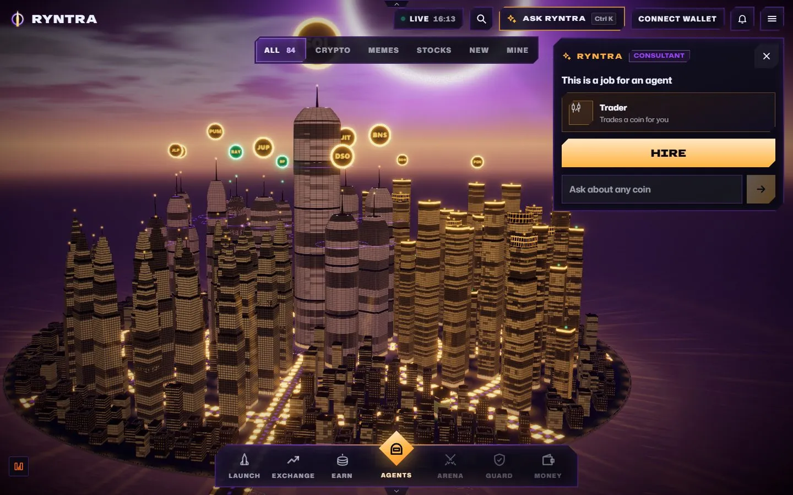 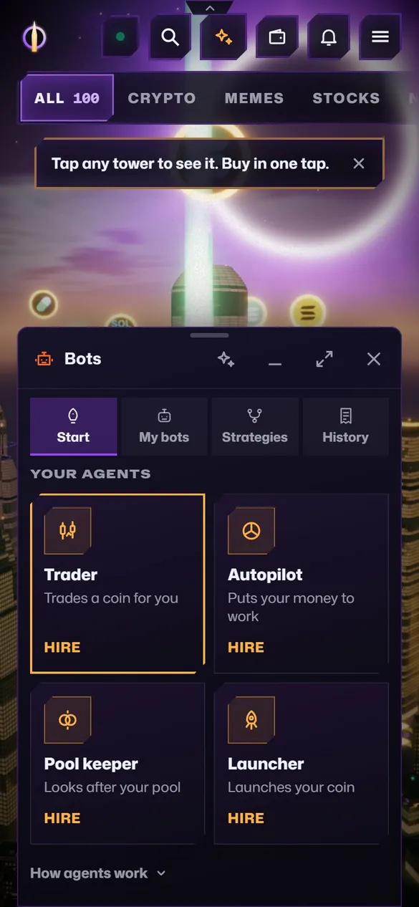
## Chapter 12: The consultant and the agents

### In plain words

Ryntra has two kinds of help, and it is always clear which one you are talking to.

**The consultant** is **Ask Ryntra** at the top of the city. Ask it anything about a coin or the market — *«what is
growing and why?»* — and it answers in a few lines and lights up the towers. It only advises: it never trades, never
signs, never holds a key. A few answers a day are free; after that each answer costs credits.

**The agents** are workers you hire in **Agents → Bots**. Each has one job: the **Trader** trades a coin for you, the
**Autopilot** puts your money to work (savings, trading, pools), the **Pool keeper** looks after your Meteora pool, the
**Launcher** launches your coin. Each works from its own budget in your wallet's vault, only inside the limits you signed,
and stops with one signature. An agent is paid only by a fee inside its own trades — no credits.

Say *«trade for me»* or *«look after my pool»* to the consultant, and it does not answer with words: it shows you the
agent who does that job and a **Hire** button.

### Your steps

1. Tap **Ask Ryntra** (on a computer: **Ctrl K**) and ask about any coin — the panel is marked **Consultant**.
2. Want work done with your money? Say it: *«trade for me»*, *«look after my pool»*, *«hire a trader»*.
3. The line shows **Hire · Trader · Agent** (or the consultant shows *This is a job for an agent*) — press **Hire**.
4. In the agent's own card read the budget and limits, then **Sign** once in your wallet; **Stop** anytime.

### How it fits together

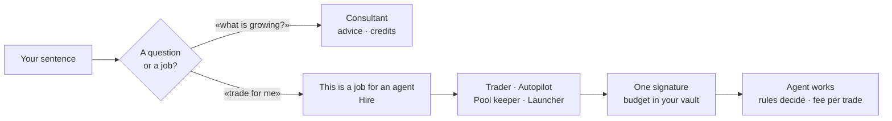

### Under the hood

- The two roles' words and the job reader: `readHire` in [city/lib/crew/read.ts](city/lib/crew/read.ts); the
  hire opens each agent's own card through [city/lib/crew/hire.ts](city/lib/crew/hire.ts).
- «Your agents» on top of Bots: [city/components/crew/Crew.tsx](city/components/crew/Crew.tsx); the consultant's
  card *This is a job for an agent*: [city/components/crew/JobCard.tsx](city/components/crew/JobCard.tsx).
- Whose model writes the consultant's words — OpenAI, Anthropic, or another through OpenRouter — is one switch of the
  deployment: [lib/agent/providers.ts](lib/agent/providers.ts). Money is never a model's call: the
  engine's rules decide every trade.
- Credits: [lib/assistant/credits/prices.ts](lib/assistant/credits/prices.ts) (an answer costs 2 credits, 1 credit
  = $0.001, 20 credits a day free).

### Honest notes

- The consultant can be wrong; its answers are information, not financial advice.
- An agent can lose money. Start with a small budget; the limits are there so a mistake stays small.
- An agent that is still being built shows **Coming** and cannot be hired yet.
