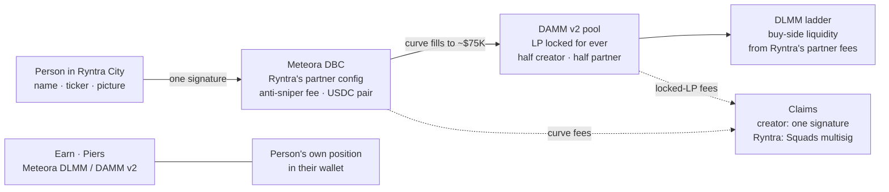
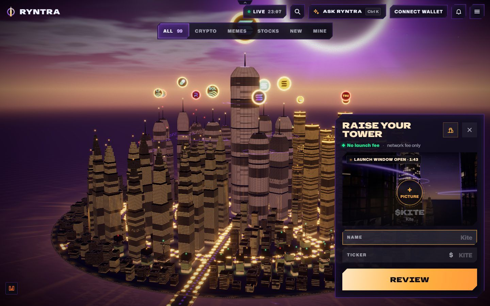
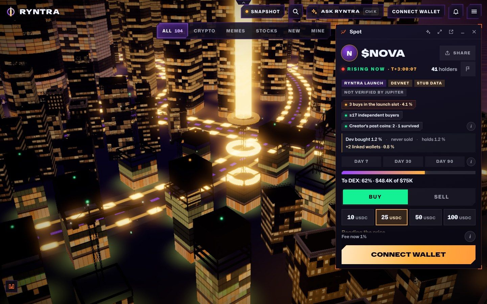
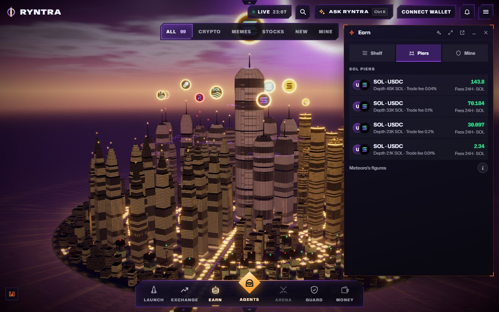
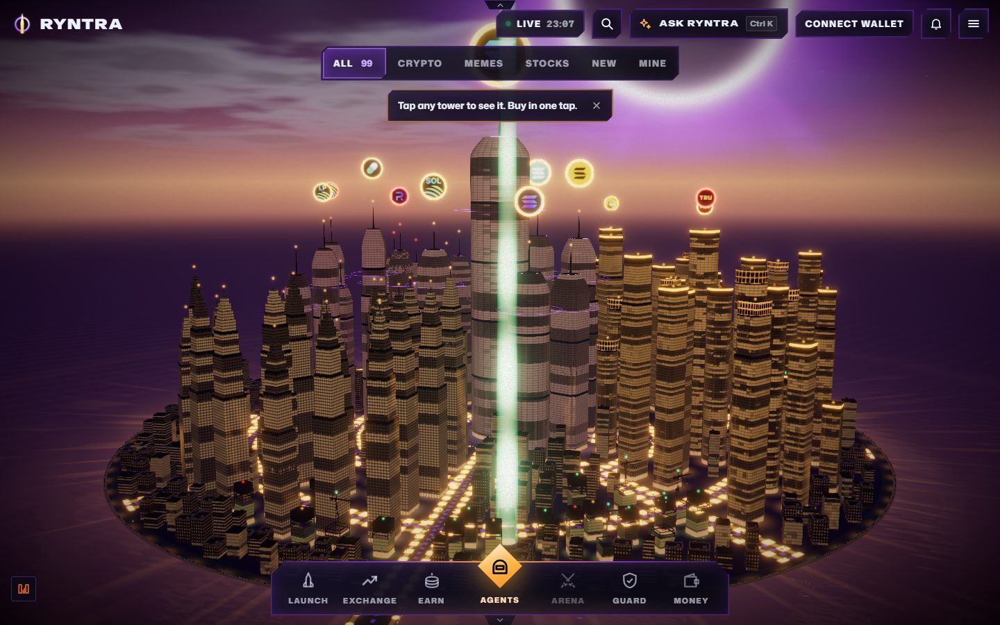
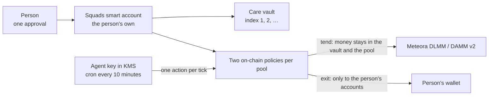

# Ryntra on Meteora

Ryntra Launch puts every new token on a Meteora Dynamic Bonding Curve (DBC) config that Ryntra created as the
partner, trades it on the curve, graduates it into a DAMM v2 pool whose liquidity is locked for ever, and can then
add buy-side DLMM liquidity paid from Ryntra's own partner fees. Creator fees can be shared through Meteora's Dynamic
Fee Sharing, a creator's first purchase can be locked in Met Lock, and an early-access format runs on an Alpha Vault.
Ryntra City's Earn district (the Harbor) lists Meteora DLMM and DAMM v2 pools and builds deposits into them. The engine
builds every transaction a person makes unsigned, and the person signs it in their own wallet; Ryntra never holds
people's funds or keys (its executor signs only its own acts, from an allowlist: graduations, its own claims, its own liquidity).
A person can also hand a DLMM or DAMM v2 position to an agent with one approval: it stays in the person's own Squads smart
account, and on-chain policies decide what the agent may do.

## In one picture



| A person launches in the city | The coin's tower on its curve |
|---|---|
|  |  |
| **The Piers in Earn: Meteora pools, the person's own position** | **The city: every coin a tower** |
|  |  |

Pictures from the live site, except the coin's window, which is the devnet stand where a curve is shown filling.

## Meteora in the code

Meteora SDKs, pinned exactly in `package.json`: `@meteora-ag/dynamic-bonding-curve-sdk` 1.5.13 and 2.0.0 side by side,
`cp-amm-sdk` 1.5.1, `dlmm` 1.9.14, `alpha-vault` 1.1.16, `dynamic-fee-sharing-sdk` 1.1.0, `met-lock-sdk` 1.0.1,
`zap-sdk` 1.3.2 and 2.0.0 side by side. One DBC and one DAMM v2 client per connection: `lib/core/venues/meteora-clients.server.ts`.

## The launch lifecycle on DBC

All paths under `lib/core/venues/meteora-dbc/` unless written in full.

| Step | What the engine does | Files |
|---|---|---|
| Presets | One immutable DBC config per preset; every number lives once in `presets.ts`, and the devnet rehearsal and the mainnet configs are built from it. Presets: Classic, Protected, Community, Micro, Advanced, plus an internal demo market for end-to-end validation. | `presets.ts` |
| Token | Token-2022, 6 decimals, 1 000 000 000 supply, mint authority revoked at creation, metadata immutable (`TokenAuthorityOption.IMMUTABLE`), no freeze authority. | `presets.ts` |
| Pair and curve | USDC pair (Community: a community token; Advanced: a pair currency from a checked register, priced, with Meteora's token badge read). Curve from $5 000 to $75 000 market cap; Micro is built for exactly 750 USDC raised (`thresholdCurve`, the inverse of the SDK's `buildCurveWithMarketCap`). Activation by timestamp. | `presets.ts`, `sdk.server.ts`, `lib/core/launch/quote-asset.ts` |
| Anti-sniper and dynamic fee | Exponential fee scheduler: 20 % falling to 1 % over 2 minutes in 30 steps (Classic, Community, Micro) or 50 % to 1 % over 10 minutes in 60 steps (Protected). Dynamic (volatility) fee on. Fees collected in the quote token. `enableFirstSwapWithMinFee`, so the creator's own first purchase pays the end fee. | `presets.ts` |
| Fee split | Creator 40 % of the curve's trading fee after Meteora's protocol share; Ryntra as partner the rest. Migration fee 2 % of the raise (40 % to the creator); Micro 8 %, all to the market's budget. Pool creation fee 0. | `presets.ts`, `lib/core/launch/preset-terms.ts` |
| Graduated pool terms | Migration to DAMM v2 only, `MigrationFeeOption.CUSTOMIZABLE`: compounding pool (50 % of the LP fee reinvested; Micro 25 %), base fee falling with market cap from 2 % to 0.5 % (Micro 0.25 %) over a 10x price move in 20 steps or 30 days, dynamic fee on. LP 100 % permanently locked, half partner and half creator. | `presets.ts` |
| "Honest launch" check | `honestLaunchProblems` refuses a config with a transfer hook, changeable metadata, unlocked or vesting LP, tokens outside the curve, a non-exponential sniper fee, a non-compounding graduated pool, or a supply that changes at graduation. Run before config bytes are returned and again on the config read back from chain. | `presets.ts`, `launch.server.ts` |
| Config creation | `buildConfig` calls `partner.createConfig` (`createConfig2` on SDK 2.0.0). Fee claimer: Ryntra's Squads vault, or the launch executor on Micro. Advanced makes one config per launch within configured bounds, optionally with a Token-2022 transfer fee until the DEX (DBC 0.2.2 via SDK 2.0.0 only). | `launch.server.ts`, `sdk.server.ts`, `lib/core/launch/advanced.ts`, `lib/core/launch/transfer-fee.ts` |
| Creation | `create` calls `createPoolWithFirstBuy`: the token and the creator's first purchase in one transaction, quoted on the fresh curve with `minimumAmountOut` equal to the quote and capped at 5 % (Protected, Micro: 2 %) of supply. No referral on that swap, so it keeps the minimum fee. Ryntra's pool payer pays the rent and the creator repays it exactly in the same transaction (simulated, sealed, simulated again; a payer that would lose a lamport refuses the build). The fresh mint key signs only after the wallet. | `launch.server.ts`, `lib/launch/flow.server.ts`, `app/api/v1/launch/build/route.ts`, `app/api/v1/launch/submit/route.ts` |
| Metadata | Name, ticker and image URI in the mint's own `TokenMetadata` extension, the metadata pointer at the mint, no update authority; the JSON is served from a fixed origin, never a request's host. Read back by decoding the mint bytes, not a second request. | `mint-metadata.ts`, `app/api/v1/launch/metadata/route.ts`, `app/api/launch/metadata/[id]/route.ts`, `lib/launch/config.server.ts` |
| Buy and sell | On the curve: `swapQuote2` at the current time (the sniper fee in force is priced), partial fill near the threshold, a slippage minimum, Ryntra's referral account. After graduation: the DAMM v2 swap. The wallet is the only signer and fee payer. | `trade.server.ts`, `lib/launch/trade.server.ts`, `app/api/v1/launch/[mint]/trade/` |
| Market read | Curve and pool state; every trade from the DBC and DAMM v2 `EvtSwap2` events decoded with each program's own coder; holders; creator, bundle and sniper labels from on-chain facts only. | `market.server.ts`, `market.ts`, `app/api/v1/launch/[mint]/market/route.ts` |
| Receipts read back from chain | Launch receipt: mint authorities and extensions, the config, the creation transaction (it must be paid by Ryntra's pool payer, the creator's purchase under the cap), and after graduation the DAMM v2 pool and its locked exit positions. Each mark (`MINT_REVOKED`, `NO_FREEZE`, `METADATA_FIXED`, `CURVE_HOLDS_FUNDS`, `LP_LOCKED_FOREVER`, `CREATOR_BUY_LOCKED` …) is drawn only when its fact holds. Trade receipt: the swap event and balance changes beside the quote the person reviewed. | `receipt.ts`, `trade-receipt.ts`, `lib/launch/view.server.ts`, `lib/launch/record.server.ts` |
| Graduation | `progress` compares the quote reserve with the threshold; `migrate` builds `migrateToDammV2`. The executor's cron sends it as soon as a curve is full and retries a failure; anyone may send it, and the log names who did. The two exit positions are found in the migration transaction itself, so no indexed RPC call is needed. | `launch.server.ts`, `exit.ts`, `exit-positions.server.ts`, `lib/launch/autopilot.server.ts`, `app/api/cron/launch-autopilot/route.ts` |
| Claims | Trading fee, migration fee, surplus and locked-LP fees (`claimPositionFee`) for both roles. The creator claims in one transaction. On Squads-vault configs every instruction of the Squads proposal is checked to be a Meteora claim that pays only into the vault's own accounts. On Micro markets Ryntra launched itself, the executor claims into the market's budget. | `claim.server.ts`, `partner.server.ts`, `partner-claim-lines.ts`, `lib/launch/creator.server.ts`, `lib/launch/partner-claims.server.ts`, `lib/solana/treasury/squads.server.ts`, `app/api/v1/launch/[mint]/claim/` |
| Fee sharing | Community and crews: right after creation the curve's creator role moves to a Dynamic Fee Sharing vault (`transfer_pool_creator`); the shares are fixed when the vault is made. | `fee-sharing.server.ts`, `lib/core/launch/fee-shares.ts` |
| Creator lock | The first purchase can go into a Met Lock escrow that no one can cancel or redirect; Micro requires at least 180 days. | `creator-lock.server.ts`, `lib/core/launch/creator-lock.ts` |
| Market Constitution | One document per market: every rule with who enforces it (an on-chain rule or a server policy) and where to check it, hashed with SHA-256. | `lib/core/launch/constitution.ts`, `lib/launch/constitution.server.ts`, `app/api/launch/[mint]/constitution/route.ts` |

## Liquidity after the curve

| What | How | Files |
|---|---|---|
| DAMM v2 holder entry | One coin in through Meteora Zap (`zap_in_damm_v2`); optionally `update_delegate_permission` for Ryntra's fee collector, which the program lets pay only the position holder's own accounts; revocable with one signature. | `lib/core/venues/meteora-damm-v2/holder.server.ts`, `lib/launch/holder.server.ts`, `app/api/v1/launch/[mint]/holder/` |
| DLMM liquidity ladder | On markets Ryntra launched itself, the executor creates the token's customizable permissionless DLMM pool if missing and places the pair currency in steps below the price (Spot shape), moving them up after the price with `go_to_a_bin` and `rebalance_liquidity`, never down. Funded from Ryntra's partner fees: bin step 100 with a 1 % fee (Classic, Protected), or bin step 250 from at most 70 % of a Micro market's budget. It is liquidity, not a price floor. | `lib/core/venues/meteora-dlmm/floor.server.ts`, `lib/core/launch/autopilot.ts`, `lib/core/launch/budget.ts`, `lib/launch/autopilot.server.ts` |
| What the executor may sign | An allowlist checked in code before the executor's key touches a transaction: DBC migration and its own partner claims, DAMM v2 fees of its own positions, its own DLMM pool and steps, compute budget. Every payout account must be its own, or for the fee collector the position holder's. | `lib/launch/executor-signing.server.ts` |
| Alpha Vault early access | Three transactions: an honest Token-2022 mint; a single-sided DAMM v2 pool with `hasAlphaVault` and the creator's position permanently locked; a permissionless FCFS or Pro Rata Alpha Vault. The bytes are read back instruction by instruction before they are returned. Deposit, fill, claim and withdraw builders. | `lib/core/venues/meteora-alpha-vault/early-access.server.ts`, `lib/core/launch/early-access.ts`, `lib/launch/early-access.server.ts`, `app/api/v1/launch/early-access/` |

## Earn

The city's Earn district, the Harbor, shows Meteora pools and lets a person put money in. A deposit of both coins adds no
Ryntra fee; a deposit from one coin through Zap pays Ryntra's swap fee on its Jupiter leg.

| Layer | Files |
|---|---|
| Meteora's DLMM and DAMM v2 Data APIs: one bounded call per pool kind, no retry on a 429, a byte ceiling; records mapped into one pool shape, malformed ones dropped | `lib/liquidity/meteora/client.server.ts`, `lib/liquidity/meteora/mapper.ts` |
| The catalogue: both APIs in parallel, kept two minutes, one venue's outage served from its last copy (up to six hours) without hiding the other | `lib/liquidity/catalog/service.server.ts`, `lib/liquidity/catalog/model.ts` |
| Chain reads: which program owns a pool, its state, DLMM bins around the price, a wallet's positions on both venues | `lib/liquidity/catalog/chain.server.ts`, `lib/liquidity/catalog/positions.ts` |
| Add, withdraw, claim built with `@meteora-ag/dlmm` and `@meteora-ag/cp-amm-sdk`; a Review builds, checks and simulates the transactions and seals them in a server-signed ticket; the relay sends only those bytes, once each | `lib/liquidity/studio/dlmm.ts`, `lib/liquidity/studio/damm-v2.ts`, `lib/liquidity/studio/venues.server.ts`, `lib/liquidity/studio/actions.ts`, `lib/liquidity/studio/ticket.ts` |
| "In the pool or just holding" and impermanent-loss tracking, shown as pictures, never as a projected return | `lib/liquidity/catalog/simulate.ts`, `lib/liquidity/catalog/track.ts` |
| One coin in, one approval: Meteora Zap, up to three v0 transactions signed together; a Review allows only the Zap, DLMM and Jupiter programs and outputs to the person's own accounts; a partial batch has an honest state and a way out as SOL | `lib/liquidity/studio/zap.ts`, `lib/liquidity/studio/zap-check.ts`, `app/api/city/earn/piers/zap/` |
| Routes | `app/api/city/harbor/route.ts`, `app/api/liquidity/` |
| The city: pools with at least $100 000 TVL, the 24 busiest, a DLMM range of 34 bins each side, the person's positions | `city/lib/districts/harbor/` |

## An agent looks after a position

A person says "look after it" and gives one approval. The agent then claims fees, reinvests them, moves a DLMM range back
to the price when the price leaves it, exits at the person's stop and reports the day.



| What | How | Files |
|---|---|---|
| Limits | The chain holds them, not our code. Policy "tend" keeps money inside the vault and the pool and bounds the active bin's slippage; policy "exit" pays fees, liquidity and rent only to the person's own accounts. No swaps, transfers, other pools or other programs | `lib/care/ssa-care.ts`, `lib/care/terms.ts` |
| One approval | Smart account if there is none, SOL into a care vault, both policies; vault 0 of the budget agent is untouched | `lib/care/enable.ts` |
| Deciding | One pure function reads the position and picks one action | `lib/care/decide.ts` |
| Acting | Meteora's SDK builds, Ryntra's signer checks, the policy executes. A DLMM range moves with `rebalance_liquidity`, which claims, withdraws and re-adds in one instruction | `lib/care/venue.server.ts`, `lib/care/signer.server.ts`, `lib/care/run.server.ts` |
| Value | A position in dollars from the pool's Meteora record; no price, no figure | `lib/care/worth.ts` |

Every path ran twice on devnet with different amounts, then on a mainnet fork, and the failures were run on purpose: the
price jumping mid-rebalance, an empty pool, a spent policy, a dead RPC, two ticks at once. Sending with the agent's raw key
around our signer, with a stranger's key, or after the stop was refused by the chain itself.

## Liquidity shapes and DLMM Pro

The Studio engine accepts Spot, Curve and Bid-Ask (`LIQUIDITY_SHAPES` in `lib/liquidity/studio/contract.ts`). The city and
the agent use Spot today. Meteora's DLMM Pro and its Wave strategy have no public program or SDK yet; Ryntra adds them
when they do, and does not imitate a shape that is not published.

## Agents

- An agent can read the presets open to people and quote one preset's fees through the agent router (HTTP and A2A):
  skills `read_fee_tariff` and `quote_launch_fee` in `lib/agent-control/external/router.ts`, served by
  `app/api/agents/router/route.ts`. The router returns no transaction, instruction or account to sign.
- `lib/agent-control/adapters/meteora-launch.ts` registers "Meteora Dynamic Bonding Curve and DAMM v2" as a read-only
  adapter and a wallet-signed launch trade as a value-transfer action. `lib/launch/record.server.ts` pins every launch
  trade's Outcome Receipt to those entries, so any verifier classifies it as moving value.
- No agent tool builds or signs a launch; every launch and launch trade is signed by the person in their own wallet.
- The one agent that acts on Meteora is the care agent above, inside the person's smart account and its policies.

## How to check it

Node 22.18 or later. Counts measured on 6 November 2026.

```bash
npm ci
node --test lib/core/venues/meteora-dbc/*.test.mjs        # 63 pass: presets, receipt, market, exit positions, SDK comparison
node --test lib/liquidity/*.test.mjs lib/liquidity/catalog/*.test.mjs lib/liquidity/studio/*.test.mjs   # 107 pass, Zap and limit orders included
node --test lib/core/launch/*.test.mjs                    # 298 pass: launch rules, ladder, budget, early access, transfer fee
node --test lib/launch/*.test.mjs                         # 307 tests; 3 skip here (they read API examples kept outside)
node --test lib/solana/treasury/launch-claims.test.mjs    # 11 pass: Squads proposal lines are Meteora claims only
node --test city/lib/launch/*.test.mjs city/lib/districts/harbor/*.test.mjs   # 287 pass
node --test lib/care/*.test.mjs                           # 12 pass: the agent's decisions, policies and failures
node --test lib/agent-control/external/router.test.mjs    # 16 pass
```

- **SDK comparison kit** (`sdk-compare-kit.mjs`, `sdk-compare.test.mjs`): DBC SDK 1.5.13 and 2.0.0 run side by side
  on the same mainnet accounts, through a connection that answers only from a fixture and throws on any request it
  does not know. It proves that constants, enums, address derivations, account decoding, quotes for every curve at
  every stage, the creator's first-buy cap, the builds of trades, launches, claims and the move to DAMM v2, and the
  events a receipt reads are identical; the only difference, `createConfig2` for a new config, is bounded by the test.
- **Fixtures**:
  - `lib/core/venues/meteora-dbc/fixtures/mainnet-dbc-accounts-2026-10-18.json` — the mainnet accounts of the
    Classic, Protected, Micro and demo configs, four curves and their mints, as read on 18 October 2026.
  - `devnet-classic-config.json`, `devnet-classic-creation.json`, `devnet-classic-observation.json` (same folder) —
    the devnet rehearsal: the config's raw bytes, the creation transaction as read, and the observation of the
    graduated token with its DAMM v2 pool and two locked exit positions.
  - `devnet-outside-launch.json` (same folder) — a token opened on the same public config without Ryntra's pool payer:
    the receipt must refuse it.
  - `lib/liquidity/studio/fixtures/dlmm.tape.json.gz`, `damm-v2.tape.json.gz` — recorded mainnet RPC answers replayed
    by `lib/liquidity/studio/rpc-cassette.ts`, so the real SDK code decodes, quotes and builds offline.
  - `lib/liquidity/catalog/fixtures/` and `lib/liquidity/meteora/fixtures/` — pages of Meteora's Data APIs as recorded.

## Status, honestly

- The launch engine and `/api/v1/launch` run on Solana mainnet since 6 October 2026, on the preset configs Ryntra
  created as the partner. The executor's cron (`vercel.json`) graduates curves and, where its stops allow, runs the ladder.
- In the city, Launch runs on mainnet: `CITY_LAUNCH_MAINNET` in `city/lib/launch/gate.ts` is the one value, and the
  deployment switch `NEXT_PUBLIC_RYNTRA_CITY_LAUNCH` closes it without a code change.
- Earn on Meteora pools is open on mainnet: the Piers in the city's Earn window list Meteora pools, and adding,
  withdrawing and claiming are open (`NEXT_PUBLIC_RYNTRA_CITY_HARBOR` in `city/lib/districts/harbor/flag.ts`; the
  actions' own gate — closed, one canary wallet up to $5, or open — in `lib/liquidity/studio/gate.ts`).
- The newer claim path is open on mainnet since 3 November 2026: a creator claims their share of the curve's fees from
  the city with one signature, and on 4 November 2026 Ryntra's partner share was claimed through the same path from
  the partner's Squads multisig (`RYNTRA_LAUNCH_CLAIMS_V2` in `lib/launch/config.server.ts`).
- Behind switches on mainnet: Advanced, Community configs, the Token-2022 transfer fee and extra pair currencies
  (`lib/launch/config.server.ts`). Early access is open on the devnet stand and closed for people on
  mainnet by a constant in `lib/launch/early-access.server.ts`. A transfer-hook preset is defined, but `buildConfig`
  refuses it until its rule program passes an independent security review.
- The care agent runs behind its own switches (`RYNTRA_AGENT_CARE`, `NEXT_PUBLIC_RYNTRA_AGENT_CARE`); the cron is `/api/cron/agent-care`.
  Its paths are proven on devnet and a mainnet fork; no person has yet handed it a position on mainnet.
- DBC SDK 1.5.13 is the default; `RYNTRA_DBC_SDK=2` moves every client call to 2.0.0, and removing it rolls back.
