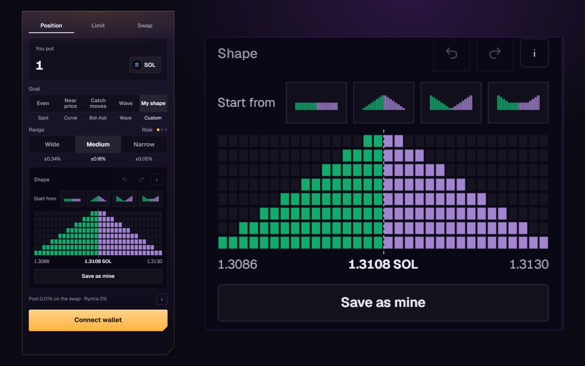
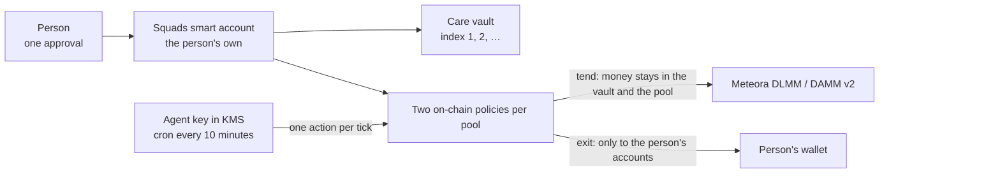

# Ryntra on Meteora

<p align="center">
  <picture>
    <source media="(max-width: 640px)" srcset="public/showcase/dlmm-pro-phone.jpg">
    
  </picture>
</p>

Ryntra builds on Meteora from the first coin to the last position. **DLMM Pro** is open to everyone in the terminal on
Solana mainnet since 18 November 2026: positions in a shape, limit orders with a maker bonus, a grid on those orders,
launches straight into a pool and an agent that looks after a position. Every launch on a curve runs on the **Dynamic
Bonding Curve** and graduates into **DAMM v2**; **DLMM** and DAMM v2 pools fill Earn. The engine builds every
transaction a person makes unsigned, and the person signs it in their own wallet; Ryntra never holds people's funds or
keys (its executor signs only its own acts, from an allowlist: graduations, its own claims, its own liquidity).

- **DLMM Pro** — positions, limit orders, the grid and launch pools; on mainnet, in Meteora's beta<br>`dPro1D5wiqnGMH8vMDG23jh35btTHoWdyqXjqkqxe8n`
- **Dynamic Bonding Curve** — launches on a curve, on mainnet<br>`dbcij3LWUppWqq96dh6gJWwBifmcGfLSB5D4DuSMaqN`
- **DAMM v2** — the pool after the curve, trading and Earn, on mainnet<br>`cpamdpZCGKUy5JxQXB4dcpGPiikHawvSWAd6mEn1sGG`
- **DLMM** — Earn, the grid and the order ladder where a coin has no DLMM Pro pool, the liquidity ladder after a launch, on mainnet<br>`LBUZKhRxPF3XUpBCjp4YzTKgLccjZhTSDM9YuVaPwxo`
- **Dynamic Fee Sharing, Met Lock, Alpha Vault and Zap** — inside launches and Earn, each below

**On this page:** [DLMM Pro](#dlmm-pro) · [The launch lifecycle on DBC](#the-launch-lifecycle-on-dbc) ·
[Liquidity after the curve](#liquidity-after-the-curve) · [Earn](#earn) ·
[An agent looks after a position](#an-agent-looks-after-a-position) · [Agents](#agents) ·
[How to check it](#how-to-check-it) · [Status, honestly](#status-honestly)

<table>
  <tr>
    <td width="50%" valign="top">
      
      <b>A DLMM Pro pool's page</b> — liquidity by price, the book, the Limit ticket.
    </td>
    <td width="50%" valign="top">
      
      <b>Launch into a DLMM Pro pool</b> — the coin's own pool.
    </td>
  </tr>
  <tr>
    <td width="50%" valign="top">
      
      <b>A DLMM pool's page</b> — the same desk for Meteora DLMM.
    </td>
    <td width="50%" valign="top">
      
      <b>A shape you paint</b> — the SDK's Custom weights, from 32 columns.
    </td>
  </tr>
</table>

The pictures are frames of the live site with no wallet connected.

## Meteora in the code

Meteora SDKs, pinned exactly in `package.json`: `@meteora-ag/dlmm-pro-sdk` 0.1.3, `@meteora-ag/dynamic-bonding-curve-sdk`
1.5.13 and 2.0.0 side by side, `cp-amm-sdk` 1.5.1, `dlmm` 1.9.14, `alpha-vault` 1.1.16, `dynamic-fee-sharing-sdk` 1.1.0,
`met-lock-sdk` 1.0.1, `zap-sdk` 1.3.2 and 2.0.0 side by side. One DLMM Pro client per connection:
`lib/core/venues/meteora-dlmm-pro/sdk.server.ts`; one DBC and one DAMM v2 client per connection:
`lib/core/venues/meteora-clients.server.ts`.

## DLMM Pro

Meteora opened the DLMM Pro beta on 12 November 2026 — program `dPro1D5wiqnGMH8vMDG23jh35btTHoWdyqXjqkqxe8n`, SDK
`@meteora-ag/dlmm-pro-sdk`. It is a program of its own, not a new DLMM shape, so Ryntra adds it as a venue of its own
beside DBC, DAMM v2 and DLMM: in the engine since 14 November, rehearsed on the program's own binary, and open to
people on mainnet since 18 November 2026.

### Four ways to build on it, and where each one is here

Meteora names four ways to build on DLMM Pro. Here is each, with what a person sees and the files that do it. Venue
paths are under `lib/core/venues/meteora-dlmm-pro/`.

**1 · Terminals — index the pools and their events.** Pools are found by the pool account's discriminator and read
through `fetchPoolWithExtensions`, with their activation rules, rewards and the fee right now; swap, order and position
events are decoded with the SDK's own coder; the bins around the price are served to the chart and the range editor.
DLMM Pro has no Data API, so the list of every pool is read from the program's own accounts too: the pair, the price,
the depth in dollars, the fee a swap pays now and what a limit order keeps on top.
- *Live:* Earn → DLMM Pro — every pool, the deepest of verified coins on top, then the ones waiting for a first position, then the rest by depth; each pool's own page with the chart, its liquidity by price
  around the pool price, its book read from the bins, the fee and the limit bonus, and the Limit ticket.
- *Files:* `pools.server.ts`, `events.server.ts`, `bins.server.ts`, `fee.ts`, `activation.ts`; routes
  `lib/pro-pools/`, `app/api/pro/pools/`, `app/api/pro/pools/[address]/`, `app/api/v1/earn/pro/piers/`, `app/api/v1/earn/pro/bins/`;
  screens `terminal/pool/` (`ProScreen.tsx`, `PoolScreen.tsx`, `Distribution.tsx`).

**2 · Liquidity providers — Spot, Curve, Bid-Ask and Custom.** One position of many ranges from a goal and a width;
paying with SOL alone swaps the part the shape needs in the same pool and opens in one approval; claim and add back in
one transaction (`compoundFees`); pool rewards as a second line.
- *Live:* in Earn and on a pool's page, a position from a goal — or from a shape the person paints on 32 columns, 16
  each side of the price, and keeps as their own; the engine lays the columns over the width's steps and builds the
  SDK's Custom shape from them.
- *Files:* `shapes.server.ts`, `goals.ts`, `positions.server.ts`, `rewards.server.ts`, `earn.server.ts`,
  `lib/earn-pro/`, `lib/core/liquidity-grid.ts`, the painter `terminal/earn/shape/`; routes `app/api/v1/earn/pro/positions/`, `review/`, `submit/`, `status/`.

**3 · Routers — a swap with a referral.** Quoted with the SDK's own math (`quoteExactIn`), the minimum taken from the
fresh quote; Ryntra's referral account added only where it exists for the coin the fee is paid in; SOL wrapped out of
the wallet and what is left unwrapped in the same transaction.
- *Live:* inside Earn, when a position is paid with one coin. *Coming:* DLMM Pro as a route of Swap.
- *Files:* `swap.server.ts`.

**4 · Launchpads — a launch pool.** Three signatures of the creator's wallet: an honest Token-2022 coin; a launch pool
whose fee against snipers falls with the market cap from 50 % to about 1 %, priced in SOL or USDC, opening at a set
time; and the supply, less an optional 5 % set to sell from ×2 to ×10 as a ladder, as one-sided positions locked for
ever, split 40 : 60 between the creator's position and Ryntra's.
- *Live:* Launch → Straight to a pool.
- *Files:* `pools.server.ts` (`initializeLaunchPool`), `lib/launch-pool/`, `lib/core/launch/dlmm-pro.ts`, routes
  `app/api/v1/launch/dlmm-pro/`.

### Built on top of it

**Limit orders with a maker bonus.** “Buy lower · sell higher”: up to 25 prices in one order, each filled at its tick's
price and earning a share of the pool's fee — on MET/SOL today, 0.60 % of what fills, with a fifth of the bonus to
Ryntra's referral, said before you sign. Ticks are relative, with a band, so an order is never placed at a price the
market has left.
- *Live:* a pool's page and a coin's Limit tab, where the coin has a DLMM Pro pool.
- *Files:* `limit-orders.server.ts`, `orders.ts`, `ladder.ts`, `lib/pro-limits/`; routes `app/api/v1/ladders/market/`,
  `quote/`, `review/`, `submit/`, `orders/`.

**Grid.** Two ladders — buys below the price, sells above it — signed in one approval. Levels are geometric, each the
same step above the last; what filled is collected and placed again on the other side of the price, and the grid's
income is counted from what really reached the wallet.
- *Live:* Bots → Grid, on DLMM Pro where the coin has a pool — MET first — and on DLMM where it does not. *Coming:* the agent placing
  again by itself — as a delegate it may only collect.
- *Files:* `lib/grid/`, `terminal/bots/Grid.tsx`.

**An agent's care.** The agent looks after a position as Meteora's delegate with three rights — fees, rewards and the
exit at the person's stop — and the program pays only into the owner's accounts. A person places a ladder with one
signature and can let the agent collect what fills, only into their own accounts.
- *Files:* `care-rules.server.ts`, `lib/earn-pro/`, `app/api/cron/agent-care/`, `app/api/cron/agent-ladders/`.

**Wave.** Meteora's fourth preset is a goal in Earn beside Even, Near price and Catch moves — even over the half of each
side nearest the price, then rising in four steps to twice that weight at the edges. It is the SDK's own
`StrategyType.Wave` (0.1.3), drawn in at most nine ranges, and a starting shape in the painter.
- *Files:* `goals.ts`, `earn.server.ts`, `terminal/earn/shape/`.

### What holds it open

- **One constant per surface**, a change of code and not a deployment's switch: `DLMM_PRO_OPEN_TO_PEOPLE`,
  `DLMM_PRO_LIMITS_MAINNET` and `DLMM_PRO_EARN_ON_MAINNET` in `gate.ts`, and the launch's own in `lib/launch-pool/gate.ts`.
  A test holds them together with the capability registry, which still reads `BUILDING` until people use them.
- **A stop for new money on each surface** — `RYNTRA_EARN_PRO_STOP`, the launch lane's state, the ladders' switch:
  taking out and taking back stay open.
- **Nothing moves without the owner.** Every build is an unsigned version-0 transaction that says what it costs; the
  person's wallet is the only payer, and the one other signer is the fresh NFT mint key of a new position or order.

### In the engine

All paths under `lib/core/venues/meteora-dlmm-pro/`. The SDK is pinned to 0.1.3 exactly.

- **Pools** — Found by the pool account's discriminator and read only through `fetchPoolWithExtensions`: a pool has a dynamic tail (activation rules, rewards) that a read of its head drops. The model carries both coins, the price, tick spacing, the pool type, the partner, the extensions, the fee right now (the schedule's step plus the volatility part) and whether a given wallet may swap or deposit yet.<br>*Files:* `pools.server.ts`, `fee.ts`, `activation.ts`
- **Launch pool** — `initializeLaunchPool` with a fee that falls as the market cap grows or with time, collected in one coin, opening times and early wallets. The build says the fee the schedule really settles at: its steps are whole basis points, so with hundreds of steps it settles above the fee asked for. A coin the program takes only with Meteora's token badge is refused before a signature, or built with the badge where it has one.<br>*Files:* `pools.server.ts`
- **Swap** — `quoteExactIn`, then `swap` with the minimum taken from the fresh quote. Ryntra's referral account is added only where it exists for the coin the fee is paid in. A swap of SOL wraps it out of the wallet and unwraps what is left in the same transaction.<br>*Files:* `swap.server.ts`
- **Limit orders** — A ladder built from a liquidity shape, relative ticks with a band, collecting part or all, closing. The program emits no event when an order fills, so each tick's fill is read from the tick itself. An order names Ryntra's referral wallet, and the build and the order's model say so — for the line a person reads before signing; a collect pays the referral only where its account can be paid and the collect with it passes a simulation, so a referral never holds a collect up. A collect says what reaches the owner — after the referral and after a coin's own transfer fee.<br>*Files:* `limit-orders.server.ts`, `orders.ts`, `shapes.server.ts`
- **Position** — Open from Spot, Curve, Bid-Ask or custom weights; add, remove, claim, `compoundFees`, lock for ever, delegate permissions. A deposit and a removal name a band of the price: inside it they land, outside it the program refuses them. Fees earned in one coin are compounded into the nearest range that takes that coin alone anywhere in the band. A deposit or an order beyond a pool's own tick-array bitmap makes the bitmap's extension first. A position of many ranges is split into transactions that fit.<br>*Files:* `positions.server.ts`, `ticks.ts`
- **Rewards** — Set up a reward slot, fund an emission, claim — the build says what a position has already accrued — and withdraw what was not earned.<br>*Files:* `rewards.server.ts`
- **Events** — Swap, order and position events decoded from a transaction's inner instructions with the SDK's own coder; the two events the program writes to the log are read from the log.<br>*Files:* `events.server.ts`
- **Transactions** — Every builder returns an unsigned version-0 transaction that carries its own compute budget, and says what it costs: the network fee, the rent of what it creates, and the part of that rent that comes back in the same transaction. A wallet that cannot pay for it — the amount, the fee and the rent together, at the chain's own threshold — is refused before a signature. The person's wallet is the only payer; the one other signer is the fresh NFT mint key of a new position or order. No Ryntra key signs.<br>*Files:* `tx.server.ts`, `venue.server.ts`, `pools.server.ts`
- **Open to people** — One constant per surface; a test holds them together with the registry's state and fails if anything outside the venue's folder and its surfaces imports it.<br>*Files:* `gate.ts`, `sdk.test.mjs`, `lib/core/capabilities.ts`

### Rehearsed before mainnet

The program's binary as deployed, read from its programdata account, ran in a local SVM with mainnet's feature set and
rent. Six paths:

- a Token-2022 coin, a launch pool whose fee falls from 50 % to 1 % and that opens at a set time, the supply as a
  one-sided position of 45 ranges locked for ever, swaps before and after the opening, a swap with the referral,
  limit-order ladders filled and collected;
- a second pool with liquidity mining;
- a third launch whose locked liquidity is two position NFTs;
- a pool that takes its fee in the coin it pays out, with a deposit of two coins while real trades move the price;
- a coin with a transfer fee of its own against SOL, and a launch priced in SOL;
- paths added later: a removal and a one-coin compound with trades between their build and their
  landing, a fee that falls with time on a pool with SOL as its first coin and three opening times, a coin that needs
  Meteora's badge, a swap's minimum after a coin's transfer fee, a swap across more than three tick arrays, a priority
  fee, an even position over the whole of a pool's prices, a frozen token account.

353 transactions landed; 58 were refused on purpose — 28 by the venue before a signature, 30 by the chain when the
venue was walked around. Every number the venue said before a signature was held to what the chain then did, the
network fee and the rent of every build among them: 2 026 checks, none off. A pool and one locked position of 45
ranges took 0.122 SOL of rent and 511 462 compute units, in three signatures after the coin; a launch priced in SOL
with 15 ranges took 0.062 SOL and two. The state that run left is the fixture the tests replay.

The surfaces were rehearsed on the same binary before they opened, each through the engine a person's screen calls:
the launch into a pool — 5 transactions and 0.094 SOL for a whole launch with its split; the limit orders — 83
transactions landed, 21 refused on purpose, 114 checks, none off, and 25 prices in one signature took 166 084 compute
units and 0.030 SOL of rent that comes back; earning and the agent's care — 74 transactions, 31 refused on purpose, 332
checks, none off; the grid — 30 transactions and 30 checks, none off, a whole cycle in five approvals. On devnet,
earning ran through the engine's own surface and the limit orders through the very routes the terminal calls.

## The launch lifecycle on DBC

All paths under `lib/core/venues/meteora-dbc/` unless written in full.

- **Presets** — One immutable DBC config per preset; every number lives once in `presets.ts`, and the devnet rehearsal and the mainnet configs are built from it. Presets: Classic, Protected, Community, Micro, Advanced, plus an internal demo market for end-to-end validation.<br>*Files:* `presets.ts`
- **Token** — Token-2022, 6 decimals, 1 000 000 000 supply, mint authority revoked at creation, metadata immutable (`TokenAuthorityOption.IMMUTABLE`), no freeze authority.<br>*Files:* `presets.ts`
- **Pair and curve** — USDC pair (Community: a community token; Advanced: a pair currency from a checked register, priced, with Meteora's token badge read). Curve from $5 000 to $75 000 market cap; Micro is built for exactly 750 USDC raised (`thresholdCurve`, the inverse of the SDK's `buildCurveWithMarketCap`). Activation by timestamp.<br>*Files:* `presets.ts`, `sdk.server.ts`, `lib/core/launch/quote-asset.ts`
- **Anti-sniper and dynamic fee** — Exponential fee scheduler: 20 % falling to 1 % over 2 minutes in 30 steps (Classic, Community, Micro) or 50 % to 1 % over 10 minutes in 60 steps (Protected). Dynamic (volatility) fee on. Fees collected in the quote token. `enableFirstSwapWithMinFee`, so the creator's own first purchase pays the end fee.<br>*Files:* `presets.ts`
- **Fee split** — Creator 40 % of the curve's trading fee after Meteora's protocol share; Ryntra as partner the rest. Migration fee 2 % of the raise (40 % to the creator); Micro 8 %, all to the market's budget. Pool creation fee 0.<br>*Files:* `presets.ts`, `lib/core/launch/preset-terms.ts`
- **Graduated pool terms** — Migration to DAMM v2 only, `MigrationFeeOption.CUSTOMIZABLE`: compounding pool (50 % of the LP fee reinvested; Micro 25 %), base fee falling with market cap from 2 % to 0.5 % (Micro 0.25 %) over a 10x price move in 20 steps or 30 days, dynamic fee on. LP 100 % permanently locked, half partner and half creator.<br>*Files:* `presets.ts`
- **"Honest launch" check** — `honestLaunchProblems` refuses a config with a transfer hook, changeable metadata, unlocked or vesting LP, tokens outside the curve, a non-exponential sniper fee, a non-compounding graduated pool, or a supply that changes at graduation. Run before config bytes are returned and again on the config read back from chain.<br>*Files:* `presets.ts`, `launch.server.ts`
- **Config creation** — `buildConfig` calls `partner.createConfig` (`createConfig2` on SDK 2.0.0). Fee claimer: Ryntra's Squads vault, or the launch executor on Micro. Advanced makes one config per launch within configured bounds, optionally with a Token-2022 transfer fee until the DEX (DBC 0.2.2 via SDK 2.0.0 only).<br>*Files:* `launch.server.ts`, `sdk.server.ts`, `lib/core/launch/advanced.ts`, `lib/core/launch/transfer-fee.ts`
- **Creation** — `create` calls `createPoolWithFirstBuy`: the token and the creator's first purchase in one transaction, quoted on the fresh curve with `minimumAmountOut` equal to the quote and capped at 5 % (Protected, Micro: 2 %) of supply. No referral on that swap, so it keeps the minimum fee. Ryntra's pool payer pays the rent and the creator repays it exactly in the same transaction (simulated, sealed, simulated again; a payer that would lose a lamport refuses the build). The fresh mint key signs only after the wallet.<br>*Files:* `launch.server.ts`, `lib/launch/flow.server.ts`, `app/api/v1/launch/build/route.ts`, `app/api/v1/launch/submit/route.ts`
- **Metadata** — Name, ticker and image URI in the mint's own `TokenMetadata` extension, the metadata pointer at the mint, no update authority; the JSON is served from a fixed origin, never a request's host. Read back by decoding the mint bytes, not a second request.<br>*Files:* `mint-metadata.ts`, `app/api/v1/launch/metadata/route.ts`, `app/api/launch/metadata/[id]/route.ts`, `lib/launch/config.server.ts`
- **Buy and sell** — On the curve: `swapQuote2` at the current time (the sniper fee in force is priced), partial fill near the threshold, a slippage minimum, Ryntra's referral account. After graduation: the DAMM v2 swap. The wallet is the only signer and fee payer.<br>*Files:* `trade.server.ts`, `lib/launch/trade.server.ts`, `app/api/v1/launch/[mint]/trade/`
- **Market read** — Curve and pool state; every trade from the DBC and DAMM v2 `EvtSwap2` events decoded with each program's own coder; holders; creator, bundle and sniper labels from on-chain facts only.<br>*Files:* `market.server.ts`, `market.ts`, `app/api/v1/launch/[mint]/market/route.ts`
- **Receipts read back from chain** — Launch receipt: mint authorities and extensions, the config, the creation transaction (it must be paid by Ryntra's pool payer, the creator's purchase under the cap), and after graduation the DAMM v2 pool and its locked exit positions. Each mark (`MINT_REVOKED`, `NO_FREEZE`, `METADATA_FIXED`, `CURVE_HOLDS_FUNDS`, `LP_LOCKED_FOREVER`, `CREATOR_BUY_LOCKED` …) is drawn only when its fact holds. Trade receipt: the swap event and balance changes beside the quote the person reviewed.<br>*Files:* `receipt.ts`, `trade-receipt.ts`, `lib/launch/view.server.ts`, `lib/launch/record.server.ts`
- **Graduation** — `progress` compares the quote reserve with the threshold; `migrate` builds `migrateToDammV2`. The executor's cron sends it as soon as a curve is full and retries a failure; anyone may send it, and the log names who did. The two exit positions are found in the migration transaction itself, so no indexed RPC call is needed.<br>*Files:* `launch.server.ts`, `exit.ts`, `exit-positions.server.ts`, `lib/launch/autopilot.server.ts`, `app/api/cron/launch-autopilot/route.ts`
- **Claims** — Trading fee, migration fee, surplus and locked-LP fees (`claimPositionFee`) for both roles. The creator claims in one transaction. On Squads-vault configs every instruction of the Squads proposal is checked to be a Meteora claim that pays only into the vault's own accounts. On Micro markets Ryntra launched itself, the executor claims into the market's budget.<br>*Files:* `claim.server.ts`, `partner.server.ts`, `partner-claim-lines.ts`, `lib/launch/creator.server.ts`, `lib/launch/partner-claims.server.ts`, `lib/solana/treasury/squads.server.ts`, `app/api/v1/launch/[mint]/claim/`
- **Fee sharing** — Community and crews: right after creation the curve's creator role moves to a Dynamic Fee Sharing vault (`transfer_pool_creator`); the shares are fixed when the vault is made.<br>*Files:* `fee-sharing.server.ts`, `lib/core/launch/fee-shares.ts`
- **Creator lock** — The first purchase can go into a Met Lock escrow that no one can cancel or redirect; Micro requires at least 180 days.<br>*Files:* `creator-lock.server.ts`, `lib/core/launch/creator-lock.ts`
- **Market Constitution** — One document per market: every rule with who enforces it (an on-chain rule or a server policy) and where to check it, hashed with SHA-256.<br>*Files:* `lib/core/launch/constitution.ts`, `lib/launch/constitution.server.ts`, `app/api/launch/[mint]/constitution/route.ts`

## Liquidity after the curve

- **DAMM v2 holder entry** — One coin in through Meteora Zap (`zap_in_damm_v2`); optionally `update_delegate_permission` for Ryntra's fee collector, which the program lets pay only the position holder's own accounts; revocable with one signature.<br>*Files:* `lib/core/venues/meteora-damm-v2/holder.server.ts`, `lib/launch/holder.server.ts`, `app/api/v1/launch/[mint]/holder/`
- **DLMM liquidity ladder** — On markets Ryntra launched itself, the executor creates the token's customizable permissionless DLMM pool if missing and places the pair currency in steps below the price (Spot shape), moving them up after the price with `go_to_a_bin` and `rebalance_liquidity`, never down. Funded from Ryntra's partner fees: bin step 100 with a 1 % fee (Classic, Protected), or bin step 250 from at most 70 % of a Micro market's budget. It is liquidity, not a price floor.<br>*Files:* `lib/core/venues/meteora-dlmm/floor.server.ts`, `lib/core/launch/autopilot.ts`, `lib/core/launch/budget.ts`, `lib/launch/autopilot.server.ts`
- **What the executor may sign** — An allowlist checked in code before the executor's key touches a transaction: DBC migration and its own partner claims, DAMM v2 fees of its own positions, its own DLMM pool and steps, compute budget. Every payout account must be its own, or for the fee collector the position holder's.<br>*Files:* `lib/launch/executor-signing.server.ts`
- **Alpha Vault early access** — Three transactions: an honest Token-2022 mint; a single-sided DAMM v2 pool with `hasAlphaVault` and the creator's position permanently locked; a permissionless FCFS or Pro Rata Alpha Vault. The bytes are read back instruction by instruction before they are returned. Deposit, fill, claim and withdraw builders.<br>*Files:* `lib/core/venues/meteora-alpha-vault/early-access.server.ts`, `lib/core/launch/early-access.ts`, `lib/launch/early-access.server.ts`, `app/api/v1/launch/early-access/`

## Earn

Earn shows Meteora pools and lets a person put money in. A deposit of both coins adds no
Ryntra fee; a deposit from one coin through Zap pays Ryntra's swap fee on its Jupiter leg.

- Meteora's DLMM and DAMM v2 Data APIs: one bounded call per pool kind, no retry on a 429, a byte ceiling; records mapped into one pool shape, malformed ones dropped<br>*Files:* `lib/liquidity/meteora/client.server.ts`, `lib/liquidity/meteora/mapper.ts`
- The catalogue: both APIs in parallel, kept two minutes, one venue's outage served from its last copy (up to six hours) without hiding the other<br>*Files:* `lib/liquidity/catalog/service.server.ts`, `lib/liquidity/catalog/model.ts`
- Chain reads: which program owns a pool, its state, DLMM bins around the price, a wallet's positions on both venues<br>*Files:* `lib/liquidity/catalog/chain.server.ts`, `lib/liquidity/catalog/positions.ts`
- Add, withdraw, claim built with `@meteora-ag/dlmm` and `@meteora-ag/cp-amm-sdk`; a Review builds, checks and simulates the transactions and seals them in a server-signed ticket; the relay sends only those bytes, once each<br>*Files:* `lib/liquidity/studio/dlmm.ts`, `lib/liquidity/studio/damm-v2.ts`, `lib/liquidity/studio/venues.server.ts`, `lib/liquidity/studio/actions.ts`, `lib/liquidity/studio/ticket.ts`
- "In the pool or just holding" and impermanent-loss tracking, shown as pictures, never as a projected return<br>*Files:* `lib/liquidity/catalog/simulate.ts`, `lib/liquidity/catalog/track.ts`
- One coin in, one approval: Meteora Zap, up to three v0 transactions signed together; a Review allows only the Zap, DLMM and Jupiter programs and outputs to the person's own accounts; a partial batch has an honest state and a way out as SOL<br>*Files:* `lib/liquidity/studio/zap.ts`, `lib/liquidity/studio/zap-check.ts`, `app/api/city/earn/piers/zap/`
- The routes the Earn shelf reads and acts through<br>*Files:* `app/api/city/harbor/route.ts`, `app/api/liquidity/`
- On a coin's own page, under its chart: **Pools** — the coin's DLMM and DAMM v2 pools with liquidity, volume and fees of
  the day — and **My pools**, the person's positions in them. Add, Review and Withdraw open the same Earn ticket in a
  drawer, so a person buys a coin, earns on it and leaves it on one screen; no new money path<br>*Files:* `terminal/coin/earn-here/`

## An agent looks after a position

A person says "look after it" and gives one approval. The agent then claims fees, reinvests them, moves a DLMM range back
to the price when the price leaves it, exits at the person's stop and reports the day.



- **Limits** — The chain holds them, not our code. Policy "tend" keeps money inside the vault and the pool and bounds the active bin's slippage; policy "exit" pays fees, liquidity and rent only to the person's own accounts. No swaps, transfers, other pools or other programs<br>*Files:* `lib/care/ssa-care.ts`, `lib/care/terms.ts`
- **One approval** — Smart account if there is none, SOL into a care vault, both policies; vault 0 of the budget agent is untouched<br>*Files:* `lib/care/enable.ts`
- **Deciding** — One pure function reads the position and picks one action<br>*Files:* `lib/care/decide.ts`
- **Acting** — Meteora's SDK builds, Ryntra's signer checks, the policy executes. A DLMM range moves with `rebalance_liquidity`, which claims, withdraws and re-adds in one instruction<br>*Files:* `lib/care/venue.server.ts`, `lib/care/signer.server.ts`, `lib/care/run.server.ts`
- **Value** — A position in dollars from the pool's Meteora record; no price, no figure<br>*Files:* `lib/care/worth.ts`

Every path ran twice on devnet with different amounts, then on a mainnet fork, and the failures were run on purpose: the
price jumping mid-rebalance, an empty pool, a spent policy, a dead RPC, two ticks at once. Sending with the agent's raw key
around our signer, with a stranger's key, or after the stop was refused by the chain itself.

## Liquidity shapes

The Studio engine for DLMM and DAMM v2 accepts Spot, Curve and Bid-Ask (`LIQUIDITY_SHAPES` in
`lib/liquidity/studio/contract.ts`); DLMM Pro adds custom weights (`shapes.server.ts`). In Earn a person picks a goal,
not a shape — Even, Near price, Catch moves or, on DLMM Pro, Wave — and a width; the Zap and the agent's care build it, and the agent
rebuilds a range in the same shape.

## Agents

- An agent can read the presets open to people and quote one preset's fees through the agent router (HTTP and A2A):
  skills `read_fee_tariff` and `quote_launch_fee` in `lib/agent-control/external/router.ts`, served by
  `app/api/agents/router/route.ts`. The router returns no transaction, instruction or account to sign.
- `lib/agent-control/adapters/meteora-launch.ts` registers "Meteora Dynamic Bonding Curve and DAMM v2" as a read-only
  adapter and a wallet-signed launch trade as a value-transfer action; `lib/launch/record.server.ts` pins every launch
  trade's Outcome Receipt to those entries, so any verifier classifies it as moving value.
- No agent tool builds or signs a launch; every launch and launch trade is signed by the person in their own wallet.
- The agents that act on Meteora act inside rules the chain holds: the care agent above, inside the person's own smart
  account and its policies; and on DLMM Pro, the agent as a position's delegate with three rights ([DLMM Pro](#dlmm-pro)).
- The trading agent buys and sells coins through Jupiter — Meteora pools among the routes — inside the person's own
  Squads policies: its exits (the stop, half at 2x, the fade, the clock) sell only into the person's wallet.

## How to check it

Node 22.18 or later. Counts measured on 19 November 2026, in a fresh clone of this repository.

```bash
npm ci

# 147 pass: DLMM Pro — fee, opening, bins, orders, ladders, ticks, earning, SDK comparison, mainnet pools
node --test lib/core/venues/meteora-dlmm-pro/*.test.mjs
# 72 pass: the DLMM Pro launch, limit orders, earning, the grid and the list of pools, each behind its gate
node --test lib/launch-pool/*.test.mjs lib/core/launch/dlmm-pro.test.mjs lib/pro-limits/*.test.mjs lib/earn-pro/*.test.mjs lib/grid/*.test.mjs lib/pro-pools/*.test.mjs
# 61 pass: DBC presets, receipt, market, exit positions, SDK comparison
node --test lib/core/venues/meteora-dbc/*.test.mjs
# 109 pass, Zap and limit orders included
node --test lib/liquidity/*.test.mjs lib/liquidity/catalog/*.test.mjs lib/liquidity/studio/*.test.mjs
# 277 pass: launch rules, ladder, budget, early access, transfer fee, the DLMM Pro launch
node --test lib/core/launch/*.test.mjs
# 296 tests; 3 skip here (they read API examples kept outside)
node --test lib/launch/*.test.mjs
# 11 pass: Squads proposal lines are Meteora claims only
node --test lib/solana/treasury/launch-claims.test.mjs
# 374 tests; 1 skips here (it reads a document kept outside)
node --test city/lib/launch/*.test.mjs city/lib/districts/harbor/*.test.mjs
# 12 pass: the care agent's decisions, policies and failures
node --test lib/care/*.test.mjs
# 16 pass
node --test lib/agent-control/external/router.test.mjs
```

- **SDK comparison kit** (`sdk-compare-kit.mjs`, `sdk-compare.test.mjs`): DBC SDK 1.5.13 and 2.0.0 run side by side
  on the same mainnet accounts, through a connection that answers only from a fixture and throws on any request it
  does not know. It proves that constants, enums, address derivations, account decoding, quotes for every curve at
  every stage, the creator's first-buy cap, the builds of trades, launches, claims and the move to DAMM v2, and the
  events a receipt reads are identical; the only difference, `createConfig2` for a new config, is bounded by the test.
- **Fixtures**:
  - `lib/core/venues/meteora-dbc/fixtures/mainnet-dbc-accounts-2026-10-18.json` — the mainnet accounts of the
    Classic, Protected, Micro and demo configs, four curves and their mints, as read on 18 October 2026.
  - `devnet-classic-config.json`, `devnet-classic-creation.json`, `devnet-classic-observation.json` (same folder) —
    the devnet rehearsal: the config's raw bytes, the creation transaction as read, and the observation of the
    graduated token with its DAMM v2 pool and two locked exit positions.
  - `devnet-outside-launch.json` (same folder) — a token opened on the same public config without Ryntra's pool payer:
    the launch receipt must refuse it.
  - `lib/liquidity/studio/fixtures/dlmm.tape.json.gz`, `damm-v2.tape.json.gz` — recorded mainnet RPC answers replayed
    by `lib/liquidity/studio/rpc-cassette.ts`, so the real SDK code decodes, quotes and builds offline.
  - `lib/liquidity/catalog/fixtures/` and `lib/liquidity/meteora/fixtures/` — pages of Meteora's Data APIs as recorded.
  - `lib/core/venues/meteora-dlmm-pro/fixtures/mainnet-pools-2026-11-14.json.gz` — every DLMM Pro pool on mainnet as
    read on 14 November 2026, with the tick arrays a swap of either direction would walk.
  - `lib/core/venues/meteora-dlmm-pro/fixtures/rehearsal.json.gz` — the rehearsal's state at ten moments and its
    transactions as a node would return them: what mainnet did not have then (a pool with activation rules and a
    market-cap fee, limit orders in every state, a reward that runs, a pool priced in SOL). `fixture-kit.mjs` answers a
    real `Connection` from them and fails on any request it does not know, so the SDK's own code decodes, quotes and
    builds offline.

## Status, honestly

- **DLMM Pro** is open to people on mainnet since 18 November 2026 — Earn, limit orders, the grid and launches into a
  pool — each surface behind its own constant and with its own stop for new money ([What holds it open](#what-holds-it-open)).
  It is Meteora's beta.
- The launch engine and `/api/v1/launch` run on Solana mainnet since 6 October 2026, on the preset configs Ryntra
  created as the partner. The executor's cron (`vercel.json`) graduates curves and, where its stops allow, runs the
  liquidity ladder. Launch on mainnet is one constant in `city/lib/launch/gate.ts`.
- Earn on Meteora DLMM and DAMM v2 pools is open on mainnet: adding, withdrawing and claiming (the actions' own gate —
  closed, one wallet first, or open — in `lib/liquidity/studio/gate.ts`).
- A creator claims their share of the curve's fees with one signature since 3 November 2026; on 4 November 2026 Ryntra's
  partner share was claimed through the same path from the partner's Squads multisig (`RYNTRA_LAUNCH_CLAIMS_V2` in
  `lib/launch/config.server.ts`).
- Behind a deployment's switches: Advanced and Community configs, the Token-2022 transfer fee and extra pair
  currencies (`lib/launch/config.server.ts`). Early access is allowed on mainnet by a constant in
  `lib/launch/early-access.server.ts`, within the bounds a deployment sets. A transfer-hook preset is defined, but
  `buildConfig` refuses it until its rule program passes an independent security review.
- The care agent for DLMM and DAMM v2 runs behind its own switches (`RYNTRA_AGENT_CARE`, `NEXT_PUBLIC_RYNTRA_AGENT_CARE`);
  the cron is `/api/cron/agent-care`. Its paths are proven on devnet and on a mainnet fork.
- DBC SDK 1.5.13 is the default; `RYNTRA_DBC_SDK=2` moves every client call to 2.0.0, and removing it rolls back.
