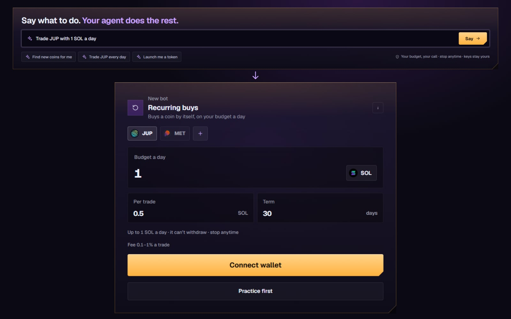
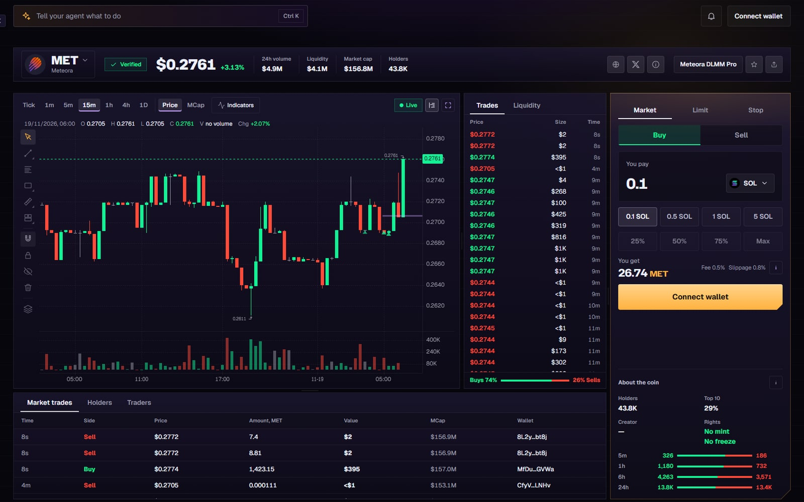
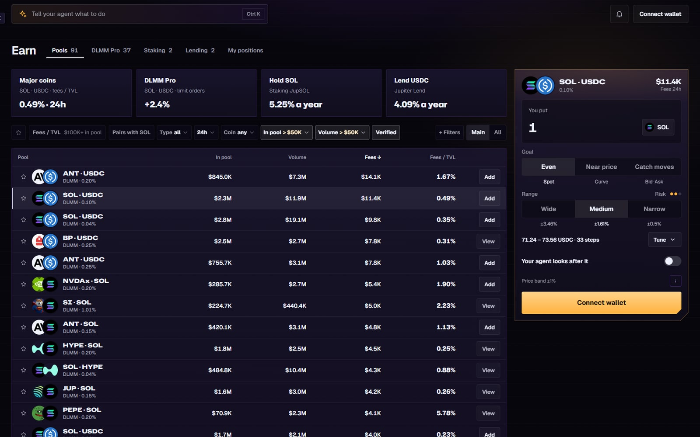
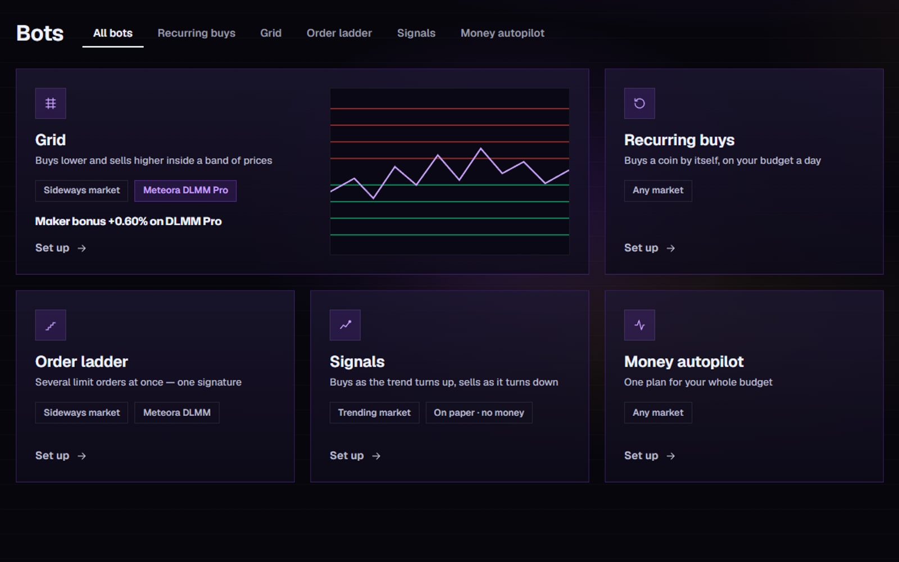
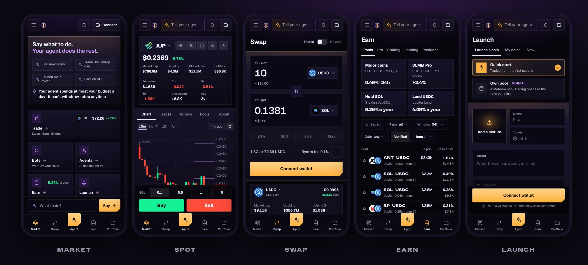
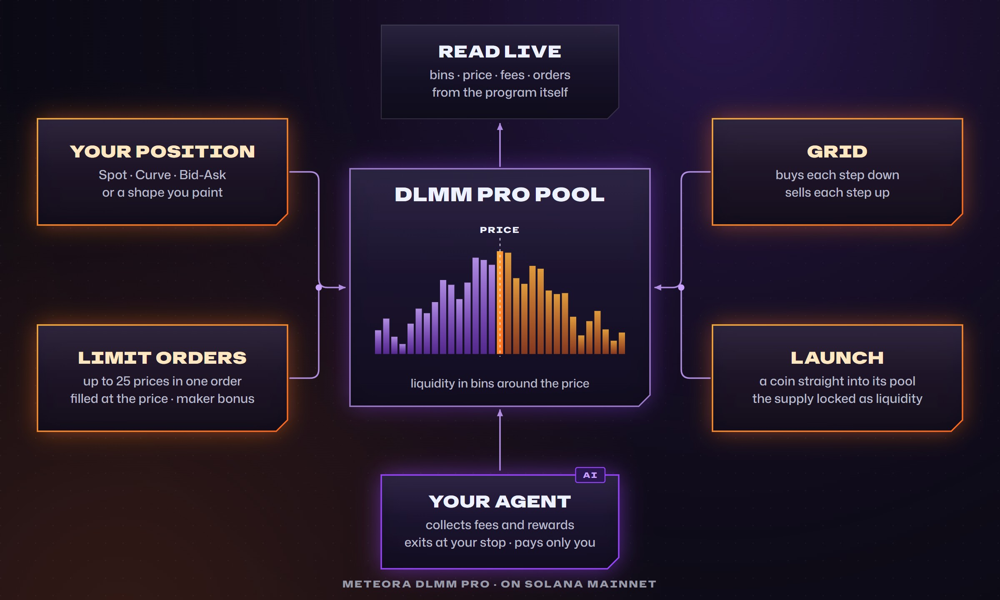
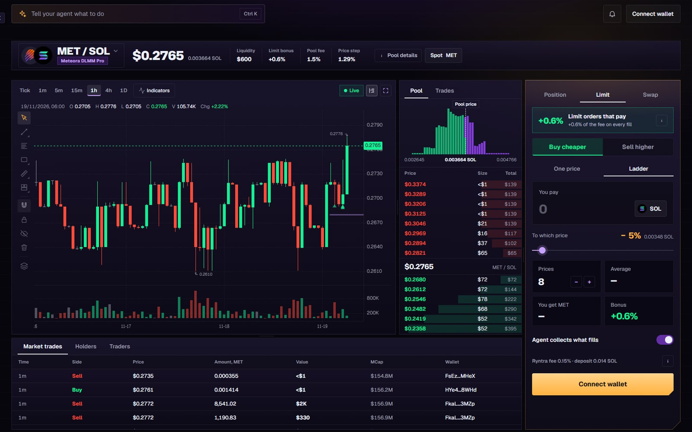
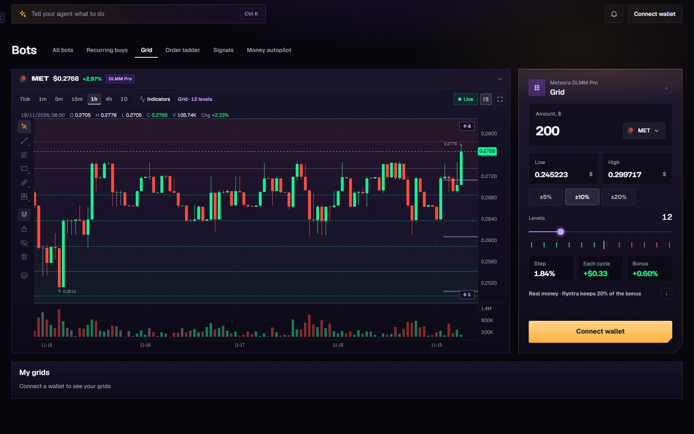
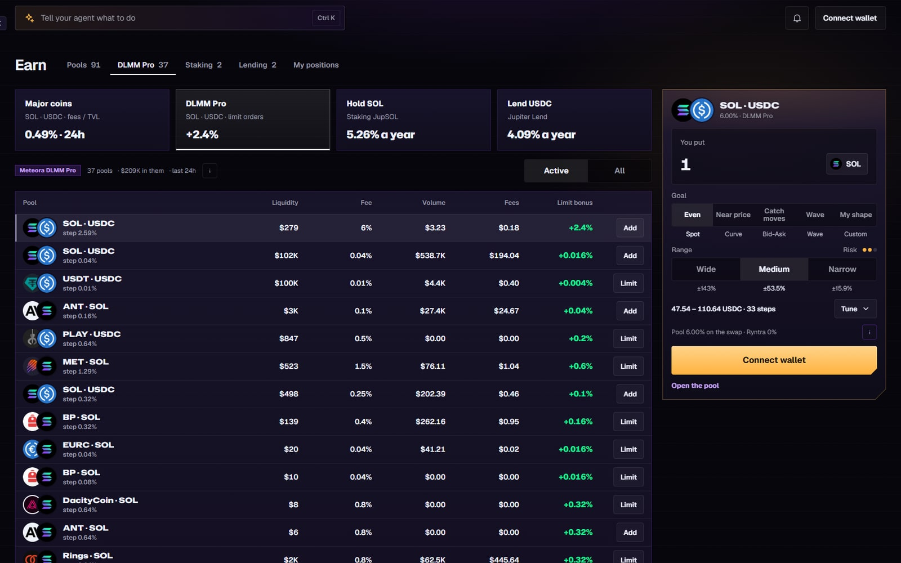
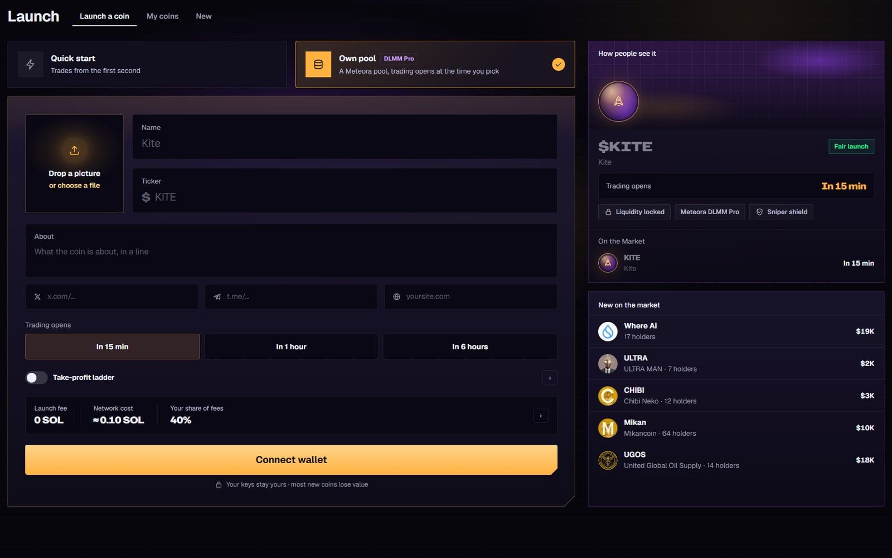

<p align="center">
  <a href="https://ryntra.io"></a>
</p>

<h3 align="center">Say it. Your agent does the rest.</h3>

<p align="center">A trading terminal for Solana with your own AI agent — built on Jupiter and Meteora, Meteora DLMM Pro included.</p>

<p align="center">
  <a href="https://ryntra.io"></a>
  <a href="#built-on-meteora-dlmm-pro"></a>
  <a href="#on-your-phone"></a>
  <a href="https://x.com/Ryntra_io"></a>
</p>

<p align="center">
  <a href="https://ryntra.io"><b>Open Ryntra</b></a> ·
  <a href="#the-terminal"><b>The terminal</b></a> ·
  <a href="#built-on-meteora-dlmm-pro"><b>Meteora DLMM Pro</b></a> ·
  <a href="#how-it-works"><b>How it works</b></a> ·
  <a href="LEARN.md"><b>Every screen</b></a>
</p>

---

Tell your agent what you want — *“trade JUP every day”*, *“launch me a token”* — sign its budget once in your own
wallet, and it does the work: buys inside your limits and reports back every day — and when you ask for a coin, it
prepares the launch for your one signature. When your take-profit or your stop is reached, it
stops buying; what it bought is already in your wallet, and you sell it with one signature. The agent selling on its
own, without your signature, is coming.

## The terminal

<table>
  <tr>
    <td width="50%" valign="top">
      
      <h4>Say it</h4>
      One sentence fills the card — the coin, the day, the limits; one signature starts it.
    </td>
    <td width="50%" valign="top">
      
      <h4>Spot</h4>
      A live chart, the coin's trades and one ticket for market, limit and stop.
    </td>
  </tr>
  <tr>
    <td width="50%" valign="top">
      
      <h4>Swap and Bridge</h4>
      Any coin for any coin through Jupiter; dollars and coins to other chains through Relay.
    </td>
    <td width="50%" valign="top">
      
      <h4>Earn</h4>
      Meteora pools, staked SOL and lending; in a pool you pick a goal — or on DLMM Pro paint your own shape.
    </td>
  </tr>
  <tr>
    <td width="50%" valign="top">
      
      <h4>Bots</h4>
      A grid, recurring buys, an order ladder — rules that keep working after one approval.
    </td>
    <td width="50%" valign="top">
      
      <h4>Launch</h4>
      Name, ticker, picture: a quick start on a Meteora curve, or straight to the coin's own pool.
    </td>
  </tr>
</table>

The home screen above is the **Market**: new launches live and every coin in one table, a buy in one tap.
**Portfolio** shows everything a wallet holds across Solana — coins, pools, staking, deposits — and collects every fee
or exits everything from one place. **Money** sends, receives and asks for a payment with a link.

### On your phone

<p align="center"></p>

Five tabs — Market · Swap · Agent · Earn · Portfolio — with the agent in the middle. The Android app in the
**Solana dApp Store** opens the same terminal full screen and signs through Mobile Wallet Adapter — Phantom, Solflare
or the Seeker's own wallet.

## Built on Meteora DLMM Pro

Meteora DLMM Pro is Meteora's new liquidity program, in beta. In Ryntra it is open to everyone on Solana mainnet:
a person builds on a pool from the terminal and signs each step in their own wallet.

<p align="center">
  <picture>
    <source media="(max-width: 640px)" srcset="public/showcase/dlmm-pro-phone.jpg">
    
  </picture>
</p>

- **Every pool, on its own page.** All DLMM Pro pools on Solana in one list, and a page for each: the chart, the
  pool's liquidity by price around the pool price, its book read from the bins, the fee and the limit bonus.
- **A goal, or your own shape.** Pick Even, Near the price or Catch moves — or paint the shape yourself on 32 columns,
  16 each side of the price, and save it as yours. One position of many ranges, paid with SOL alone if you like.
- **Limit orders with a maker bonus.** Up to 25 prices in one order, each filled at its own price; a filled order
  earns part of the pool's fee — on a pool's page and a coin's Limit tab.
- **Grid.** Buys each step down and sells each step up on DLMM Pro limit orders, both sides in one approval — in Bots.
- **Launch straight into a pool.** No curve: the coin trades in its own pool from the time you pick, a fee against
  snipers falls as it grows, and the supply goes in as liquidity locked for ever — in Launch.
- **Your agent looks after it.** As Meteora's delegate with three rights — fees, rewards and the exit at your stop —
  and the program pays only into your accounts.

<p align="center"></p>
<p align="center"><b>A pool's page</b> — MET/SOL on Meteora DLMM Pro: its liquidity by price, its book, and a ladder of limit orders with the bonus.</p>

<table>
  <tr>
    <td width="50%" valign="top">
      
      <b>Your shape</b> — painted on the pool's page, saved as yours.
    </td>
    <td width="50%" valign="top">
      
      <b>Grid</b> — levels on MET's chart, both sides in one approval, the bonus on every fill.
    </td>
  </tr>
  <tr>
    <td width="50%" valign="top">
      
      <b>Every pool</b> — the deepest on top, then the ones waiting for a first position.
    </td>
    <td width="50%" valign="top">
      
      <b>Launch</b> — straight into the coin's own pool, at the time you pick.
    </td>
  </tr>
</table>

Program `dPro1D5wiqnGMH8vMDG23jh35btTHoWdyqXjqkqxe8n` · SDK `@meteora-ag/dlmm-pro-sdk` 0.1.2, pinned · every path
rehearsed on the program's own binary before mainnet. **[METEORA.md](METEORA.md#dlmm-pro)** maps each piece to its
file, with the tests that prove it.

## How it works

<p align="center">
  <picture>
    <source media="(max-width: 640px)" srcset="public/showcase/how-it-works-phone.jpg">
    
  </picture>
</p>

A model reads your sentence and the engine checks it into one card — the coin, the amount a day, the limits. One
signature turns the card into rules on Solana: a Squads smart account holds the budget, the cap on each trade, the
venues, and the rule that what it buys can only arrive in your own wallet. Inside rules the chain holds, the agent only
buys through Jupiter and looks after your pools on Meteora. Everything else — a swap, a bridge, a launch, a deposit —
the engine builds unsigned, and you sign it yourself.

Your keys stay with you: every transaction of yours is shown and signed in your own wallet. The agent signs its trades
with its own key — Ryntra's, held in Google Cloud KMS — only inside limits that live on-chain, and one signature of
yours stops it.

<details>
<summary><b>Where each part lives in the code</b></summary>

- **The terminal** — the frame, the shelves, the agent's line: [`terminal/`](terminal), [`app/(terminal)/`](app/(terminal))
- **From a sentence to a card** — [`lib/sentence/`](lib/sentence), [`city/lib/command/`](city/lib/command)
- **The budget as a Squads policy** — [`lib/mandate/ssa.ts`](lib/mandate/ssa.ts), [`lib/mandate/terms.ts`](lib/mandate/terms.ts)
- **The agent's strategies, take-profit and stop** — [`lib/mandate/strategy.ts`](lib/mandate/strategy.ts), [`lib/mandate/tick.server.ts`](lib/mandate/tick.server.ts)
- **The agent's key, and its trade read before the key signs** — [`lib/mandate/signer.server.ts`](lib/mandate/signer.server.ts), [`lib/mandate/judge.ts`](lib/mandate/judge.ts)
- **Trading through Jupiter** — [`lib/core/venues/jupiter.ts`](lib/core/venues/jupiter.ts), [`city/lib/trade/`](city/lib/trade)
- **Meteora DLMM Pro** — [`terminal/pool/`](terminal/pool), [`lib/core/venues/meteora-dlmm-pro/`](lib/core/venues/meteora-dlmm-pro), [`lib/earn-pro/`](lib/earn-pro), [`lib/pro-limits/`](lib/pro-limits), [`lib/grid/`](lib/grid), [`lib/launch-pool/`](lib/launch-pool)
- **Launches on DBC and DAMM v2, Earn on DLMM** — [`lib/core/venues/`](lib/core/venues), [`lib/launch/`](lib/launch), [`lib/liquidity/`](lib/liquidity)
- **A transaction or a link checked before a signature** — [`lib/ward/`](lib/ward)
- **The versioned API** — [`app/api/v1/`](app/api/v1)

</details>

## Grants and hackathons

- **Colosseum Crypto World's Fair**, October 2026 — what was built during the hackathon, counted file by file
  [below](#built-during-the-hackathon). *Judging.*
- **Meteora's Dynamic Bonding Curve track**, October 2026 — launches on DBC with a move to DAMM v2. *Submitted; launches
  live on mainnet.*
- **Clock In by Solana Mobile**, October 2026 — the Android app in the Solana dApp Store. *Live.*
- **Solana Foundation, AI**, November 2026 — the agent's safety layer as open code under Apache-2.0. *Applied: the
  layer runs in production; the packages are not published yet.*
- **Solana Mobile Builder Grants**, November 2026 — the agent's report as a native notification, launch from the
  camera, Seeker. *Applied: the work starts with the grant.*

**[GRANTS.md](GRANTS.md)** puts each promise beside the code that keeps it — and says plainly what is not built yet.

## Inside this repository

| Path | What lives there |
|---|---|
| [`terminal/`](terminal) | The terminal: its frame and every shelf |
| [`app/`](app) | The Next.js app: the pages and the versioned API |
| [`lib/`](lib) | The engine: venues, the agent's rules, Earn, launches, payouts |
| [`city/`](city) | Client logic the terminal stands on — tickets, money, launches, the agent's sentence |
| [`packages/`](packages) | Libraries with their own interface: the API client, developer kits |
| [`apps/mobile/`](apps/mobile) | The Android app — Expo and React Native, Mobile Wallet Adapter |
| [`supabase/`](supabase) | The database schema, migration by migration |
| [`public/`](public) | Static assets and these pictures |

7,791 files, each test beside the code it tests. Every update of this repository is one commit named for what
shipped; the latest is from 2026-11-19.

**Built with** Next.js 15 · React 19 · TypeScript · Solana Kit and web3.js · Jupiter · Meteora DLMM Pro, DLMM, DBC and
DAMM v2 · Squads · Relay · Supabase · Expo and React Native · Vercel.

<details>
<summary><b>Run it</b></summary>

Node 22.18 or later (`package.json` asks for `>=22 <25`).

```bash
npm ci
NEXT_PUBLIC_RYNTRA_TERMINAL=open npm run dev     # http://localhost:3000 — the terminal
```

```bash
npm test             # unit and contract tests
npm run typecheck
npm run lint
NODE_OPTIONS=--max-old-space-size=8192 npm run build    # the production build checks the whole app's types
```

The app starts with no environment variables. What needs a provider says so on its own screen: trading asks for a
Jupiter API key (`RYNTRA_JUPITER_API_KEY`), accounts for Supabase (`SUPABASE_URL`, `SUPABASE_ANON_KEY`). Put them in
`.env.local`; no secret is ever committed here. A few tests read documents kept outside this repository and report
themselves as skipped.

**The Android app** — the same Node, JDK 17 and the Android SDK (platform 36, build-tools 36.0.0, NDK 27.1), with
`JAVA_HOME` and `ANDROID_HOME` set:

```bash
cd apps/mobile
npm ci
npm test
npx uniwind generate-artifacts --css ./src/global.css --dts ./src/uniwind-types.d.ts
npm run typecheck
npm run release:android -- --unsigned --abi=arm64-v8a    # an APK in apps/mobile/dist/, to sign with your own key
```

</details>

<details>
<summary><b>Open and closed</b></summary>

This repository is the code of the product as it is released — public so that anyone can read and evaluate it. It is
built from Ryntra's development repository by one command, never by hand: an allowlist decides which files are here;
task numbers and development notes are taken out of comments; gates refuse any secret, private address or internal
word, and any import that leaves this tree; a fresh clone is installed, typechecked, linted, tested and built — the web
app and the Android app — before one commit, named for what shipped.

**Deliberately closed:** keys and environment values; the plans, research and working notes of the team; the coding
assistants' instructions; and the separate products of the development repository.

**Open source:** [ryntra-solana-evidence](https://github.com/ryntra-io/ryntra-solana-evidence), Ryntra's TypeScript kit
for Solana tokens, is published separately under Apache-2.0.

</details>

## Built during the hackathon

The code as it stood before the hackathon is tagged `pre-hackathon-baseline-2026-09-11` in the development repository (commit `7fc5776f`,
2026-09-11). Since then, for the 7,791 files here:

| New | Changed | Unchanged | Lines |
|:---:|:---:|:---:|:---:|
| 6,067 | 899 | 825 | +1,252,976 / −28,166 |

[BOUNDARY.md](BOUNDARY.md) lists every new and every changed file.

## Learn more

- **[LEARN.md](LEARN.md)** — every screen in plain words, with the code behind it
- **[METEORA.md](METEORA.md)** — how Ryntra uses Meteora, DLMM Pro first, file by file
- **[GRANTS.md](GRANTS.md)** — what we applied for, and the code behind each promise
- **[SECURITY.md](SECURITY.md)** — reporting a vulnerability

[hello@ryntra.io](mailto:hello@ryntra.io) · [@Ryntra_io on X](https://x.com/Ryntra_io) · [ryntra.io](https://ryntra.io)

© 2026 Ryntra. All rights reserved. The source is public so anyone can read and evaluate it — see [LICENSE](LICENSE).
The open-source kit is published separately under Apache-2.0.
