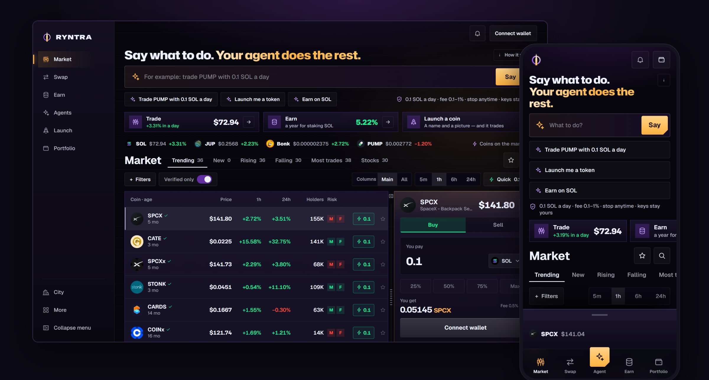
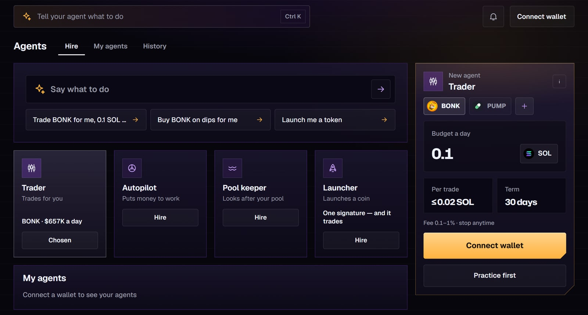
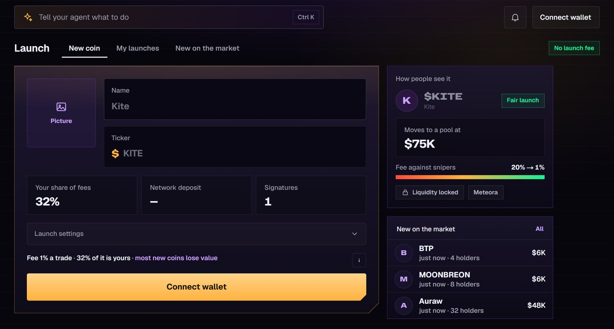
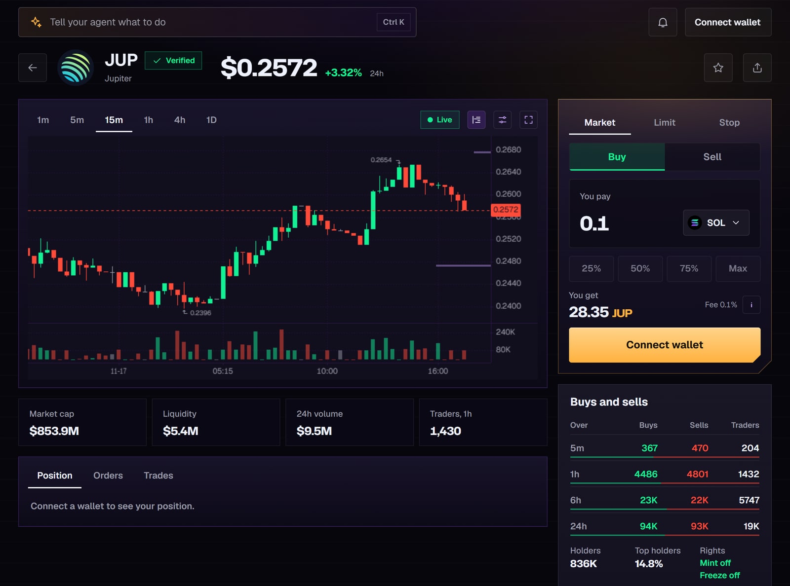
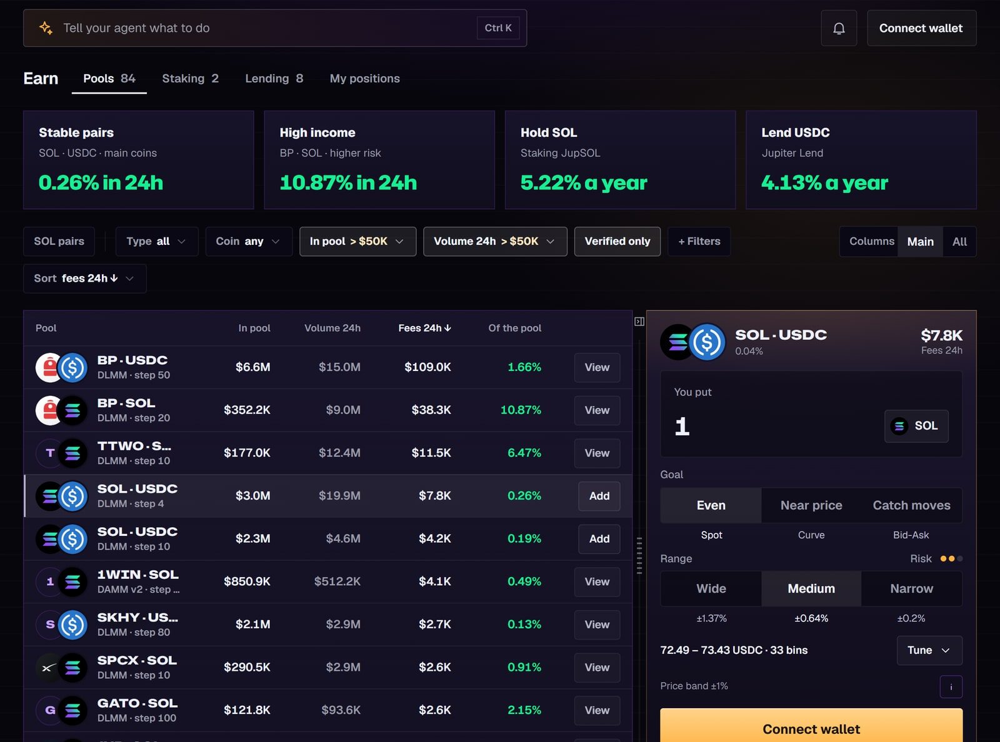
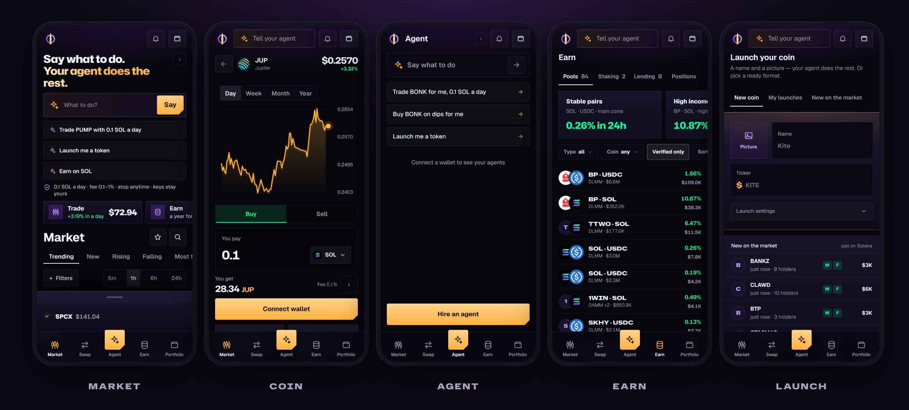
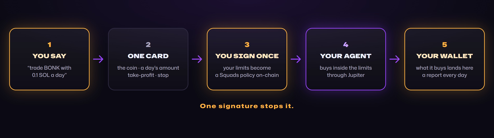
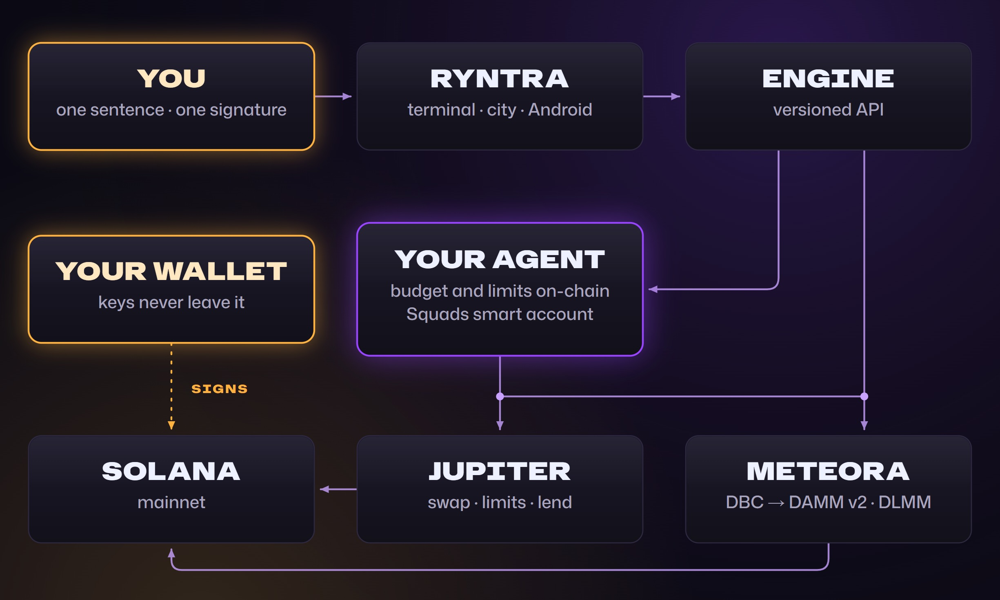

<p align="center">
  <a href="https://ryntra.io"></a>
</p>

<p align="center">
  <a href="https://ryntra.io"></a>
  <a href="https://ryntra.io"></a>
  <a href="#on-your-phone"></a>
  <a href="https://x.com/Ryntra_io"></a>
</p>

<p align="center">
  <a href="https://ryntra.io"><b>Open Ryntra</b></a> ·
  <a href="#how-it-works"><b>How it works</b></a> ·
  <a href="METEORA.md"><b>Ryntra on Meteora</b></a> ·
  <a href="GRANTS.md"><b>Grants and hackathons</b></a> ·
  <a href="LEARN.md"><b>Every feature</b></a>
</p>

---

Ryntra is a trading terminal for Solana with your own AI agent on every screen. Tell your agent what you want —
*“launch me a coin”*, *“trade BONK with 0.1 SOL a day”* — sign its budget once in your own wallet, and it does the
work: buys inside your limits, puts idle dollars to work and reports back every day — and when you ask for a coin,
it prepares the launch for your one signature. When your take-profit or your stop is reached, it stops buying; what it bought is already in your wallet, and you sell it with
one signature. The agent selling on its own, without your signature, is coming. The whole market is also a living 3D
city where every coin is a tower — a view of its own at [ryntra.io/city](https://ryntra.io/city).

## Why Ryntra

- **Your agent does the work.** One sentence becomes a plan on one card; one signature hires the agent. No bot to set
  up, no strategy to code, no screen to watch.
- **The chain holds the budget.** The per-trade and per-day limits, the venues and the rule that what the agent buys
  can only arrive in your wallet live in a Squads smart-account policy on Solana, not on our servers.
- **Your keys stay with you.** Ryntra never holds your funds or your keys, and every fee is shown before you sign.

## What runs today

Eight shelves on the left of the screen: Market · Swap · Futures · Predictions · Earn · Agents · Launch · Portfolio.
Six are open on [ryntra.io](https://ryntra.io); Futures on Phoenix and Predictions are coming to the terminal.

<table>
  <tr>
    <td width="50%" valign="top">
      
      <h4>🤖 Agents</h4>
      One sentence becomes a plan — steady buys, buys on dips, buy grids, new launches, each with an optional take-profit and stop.
      Practise on paper, then sign the budget once; the agent buys by itself and stops when you say.
    </td>
    <td width="50%" valign="top">
      
      <h4>🚀 Launch</h4>
      Name, ticker, picture, one signature. The coin starts on a Meteora bonding curve with a fee against snipers, and
      at about $75K it moves into a pool by itself.
    </td>
  </tr>
  <tr>
    <td width="50%" valign="top">
      
      <h4>📈 Trade</h4>
      Every verified coin with a live chart. Buy or sell in one signature — routed through Jupiter, the fee shown before
      you sign. Limits and stops on the same ticket; Swap also bridges USDC between Solana and other networks.
    </td>
    <td width="50%" valign="top">
      
      <h4>💰 Earn</h4>
      Put SOL or dollars to work in one signature — Meteora pools, staked SOL or Jupiter Lend. In a pool you pick a
      goal, not a shape, and the position stays in your wallet.
    </td>
  </tr>
</table>

**Portfolio** shows every coin of your wallet in one place. **Partners** bring people to Ryntra and earn a share of
its fee, paid weekly in USDC.

Your keys stay with you: every transaction of yours is shown and signed in your own wallet. The agent signs its trades
with its own key — Ryntra's, held in Google Cloud KMS — only inside limits that live on-chain, and one signature of
yours stops it.

## On your phone

<p align="center"></p>

Five tabs — Market · Swap · Agent · Earn · Portfolio — with the agent in the middle. The Android app in the
**Solana dApp Store** opens ryntra.io full screen and signs through Mobile Wallet Adapter — Phantom, Solflare or the
Seeker's own wallet. Any phone browser opens the same terminal at [ryntra.io](https://ryntra.io).

## How it works

### Your agent, from a sentence to your wallet

<p align="center">
  <picture>
    <source media="(max-width: 640px)" srcset="public/showcase/agent-flow-phone.jpg">
    
  </picture>
</p>

### How it fits together

<p align="center">
  <picture>
    <source media="(max-width: 640px)" srcset="public/showcase/how-it-fits-phone.jpg">
    
  </picture>
</p>

The engine builds your transactions unsigned, and you sign them in your wallet. The agent acts only inside the budget
you signed for it: it never sees your key, and what it buys can only arrive in your own wallet. Before the agent's key
signs, its trade is read the way the Squads program will read it, and one the chain would refuse is not sent; the
day's cap the chain enforces itself ([`lib/mandate/judge.ts`](lib/mandate/judge.ts)). Anyone can check a transaction
or a Ryntra payment link before signing it: the engine simulates the exact bytes and says what they would move
([`lib/ward/`](lib/ward)).

<details>
<summary><b>Where each part lives in the code</b></summary>

| Part | Files |
|---|---|
| The terminal: the frame, the shelves, the agent's line | [`terminal/`](terminal), [`app/(terminal)/`](app/(terminal)) |
| From a sentence to a plan | [`city/lib/command/`](city/lib/command), [`lib/mandate/plans.ts`](lib/mandate/plans.ts) |
| The budget as a Squads policy | [`lib/mandate/ssa.ts`](lib/mandate/ssa.ts), [`lib/mandate/terms.ts`](lib/mandate/terms.ts) |
| The agent's strategies, take-profit and stop | [`lib/mandate/strategy.ts`](lib/mandate/strategy.ts), [`lib/mandate/tick.server.ts`](lib/mandate/tick.server.ts) |
| The agent's key: KMS on mainnet | [`lib/mandate/agent-service.server.ts`](lib/mandate/agent-service.server.ts), [`lib/mandate/signer.server.ts`](lib/mandate/signer.server.ts) |
| The agent's trade read before its key signs | [`lib/mandate/judge.ts`](lib/mandate/judge.ts) |
| A transaction or a link checked before a signature | [`lib/ward/`](lib/ward), [`app/api/v1/ward/check/`](app/api/v1/ward/check) |
| Trading through Jupiter | [`city/lib/trade/`](city/lib/trade), [`lib/core/`](lib/core) |
| Launches and pools on Meteora | [`lib/core/venues/`](lib/core/venues), [`lib/launch/`](lib/launch) — see [METEORA.md](METEORA.md) |
| The versioned API | [`app/api/v1/`](app/api/v1) |

</details>

## Ryntra on Meteora

Every coin launched on Ryntra starts on Meteora: a Dynamic Bonding Curve config Ryntra created as the partner, then a
DAMM v2 pool with its liquidity locked for ever. Earn lists Meteora DLMM and DAMM v2 pools and builds deposits into
them. Meteora DLMM Pro is in the engine — a launch straight into a pool, limit-order ladders and positions an agent
looks after — and rehearsed on the program's deployed binary; it is not open to people yet.

- **Dynamic Bonding Curve** — launches, on mainnet<br>`dbcij3LWUppWqq96dh6gJWwBifmcGfLSB5D4DuSMaqN`
- **DAMM v2** — the pool after the curve, trading and Earn, on mainnet<br>`cpamdpZCGKUy5JxQXB4dcpGPiikHawvSWAd6mEn1sGG`
- **DLMM** — Earn and the liquidity ladder, on mainnet<br>`LBUZKhRxPF3XUpBCjp4YzTKgLccjZhTSDM9YuVaPwxo`
- **DLMM Pro** — in the engine, closed to people<br>`dPro1D5wiqnGMH8vMDG23jh35btTHoWdyqXjqkqxe8n`
- **Dynamic Fee Sharing, Met Lock, Alpha Vault and Zap** — behind switches or inside Earn, each with its own section in
  [METEORA.md](METEORA.md)

Ryntra's own accounts — its configs, the pool payer and the executor — are listed in
[`lib/attribution/registry.ts`](lib/attribution/registry.ts). **[METEORA.md](METEORA.md)** takes every step file by
file, with the tests that prove it.

## Grants and hackathons

- **Colosseum Crypto World's Fair**, October 2026 — what was built during the hackathon, counted file by file
  [below](#built-during-the-hackathon). *Judging.*
- **Meteora's Dynamic Bonding Curve track**, October 2026 — launches on DBC with a move to DAMM v2. *Submitted; launches live on mainnet.*
- **Clock In by Solana Mobile**, October 2026 — the Android app in the Solana dApp Store. *Live.*
- **Solana Foundation, AI**, November 2026 — the agent's safety layer as open code under Apache-2.0. *Applied: the
  layer runs in production; the packages are not published yet.*
- **Solana Mobile Builder Grants**, November 2026 — the agent's report as a native notification, launch from the
  camera, Seeker. *Applied: the work starts with the grant.*

**[GRANTS.md](GRANTS.md)** puts each promise beside the code that keeps it — and says plainly what is not built yet.

## Open and closed

This repository is the code of the product as it is released — the web app, the terminal, the city, the engine, the
database schema and the Android app — public so that anyone can read and evaluate it. It is built from Ryntra's
development repository by one command, never by hand:

<details>
<summary><b>How an update is built</b></summary>

1. **A list decides.** A file is here because an allowlist names its directory and a regenerated file list names the
   file itself; everything else stays behind.
2. **Notes come out.** Task numbers and development notes are taken out of comments; the code is untouched.
3. **Gates.** No secret, no private address, no internal word; every import resolves inside this tree.
4. **A fresh clone.** The candidate is installed from its lockfile, typechecked, linted, tested and built — the web
   app and the Android app — before it is committed.
5. **One commit per update,** named for what shipped.

</details>

**Deliberately closed:** keys and environment values; the plans, research and working notes of the team; the coding
assistants' instructions; and the separate products of the development repository. They are not part of what runs
here, and the plans carry decisions still in progress.

**Open source:** [ryntra-solana-evidence](https://github.com/ryntra-io/ryntra-solana-evidence), Ryntra's TypeScript kit
for Solana tokens, is published separately under Apache-2.0.

## Inside this repository

| Path | What lives there |
|---|---|
| [`terminal/`](terminal) | The terminal — its frame and shelves: market, coin, swap, earn, agents, launch, portfolio |
| [`city/`](city) | Ryntra City — the 3D market (React Three Fiber) — and the logic the terminal shares with it |
| [`app/`](app) | The Next.js app: the pages and the versioned API behind the terminal and the phone |
| [`lib/`](lib) | The engine — trading and launches, the agent's mandate and strategies, Earn, accounts, payouts |
| [`packages/`](packages) | Libraries with their own interface: the API client the phone uses, developer kits |
| [`apps/mobile/`](apps/mobile) | The Android app — Expo and React Native, Mobile Wallet Adapter |
| [`supabase/`](supabase) | The database schema, migration by migration |
| [`public/`](public) | Static assets, the city's models and these pictures |

7,486 files, each test beside the code it tests. Every update of this repository is one commit named for what
shipped; the latest is from 2026-11-17.

**Built with** Next.js 15 · React 19 · TypeScript · Three.js and React Three Fiber · Solana Kit and web3.js · Jupiter ·
Meteora DBC, DAMM v2, DLMM and DLMM Pro · Squads · Supabase · Expo and React Native · Vercel.

## Run it

Node 22.18 or later (`package.json` asks for `>=22 <25`).

```bash
npm ci
npm run dev          # http://localhost:3000 — Ryntra
```

<details>
<summary><b>Tests, types and the production build</b></summary>

```bash
npm test             # unit and contract tests
npm run typecheck
npm run lint
npm run build        # the production build
```

The production build checks the types of the whole app in one go; give Node 8 GB for it:
`NODE_OPTIONS=--max-old-space-size=8192 npm run build`.

The app starts with no environment variables. What needs a provider says so on its own screen: trading asks for a
Jupiter API key (`RYNTRA_JUPITER_API_KEY`), accounts for Supabase (`SUPABASE_URL`, `SUPABASE_ANON_KEY`). Put them in
`.env.local`; no secret is ever committed here. The terminal is switched on by `NEXT_PUBLIC_RYNTRA_TERMINAL=open`;
without it `/` shows the city. A few tests read documents kept outside this repository and report themselves as
skipped.

</details>

<details>
<summary><b>The Android app</b></summary>

The same Node, JDK 17 and the Android SDK (platform 36, build-tools 36.0.0, NDK 27.1), with `JAVA_HOME` and
`ANDROID_HOME` set.

```bash
cd apps/mobile
npm ci
npm test
npx uniwind generate-artifacts --css ./src/global.css --dts ./src/uniwind-types.d.ts
npm run typecheck
```

With a phone or an emulator connected, `npx expo run:android` builds and installs a development build. A standalone
APK without the release key:

```bash
npm run release:android -- --unsigned --abi=arm64-v8a
```

It lands in `apps/mobile/dist/`; sign it with your own key (`apksigner sign --ks <your.keystore> <apk>`) before
`adb install`.

</details>

## Built during the hackathon

The code as it stood before the hackathon is tagged `pre-hackathon-baseline-2026-09-11` in the development repository (commit `7fc5776f`,
2026-09-11). Since then, for the 7,486 files here:

| New | Changed | Unchanged | Lines |
|:---:|:---:|:---:|:---:|
| 5,762 | 899 | 825 | +1,201,091 / −28,158 |

[BOUNDARY.md](BOUNDARY.md) lists every new and every changed file.

## Learn more

- **[LEARN.md](LEARN.md)** — every feature in plain words, with the files that do it (also at [ryntra.io/learn](https://ryntra.io/learn))
- **[METEORA.md](METEORA.md)** — how Ryntra uses Meteora, file by file
- **[GRANTS.md](GRANTS.md)** — what we applied for, and the code behind each promise
- **[ryntra-solana-evidence](https://github.com/ryntra-io/ryntra-solana-evidence)** — Ryntra's open-source TypeScript kit for Solana tokens (Apache-2.0)
- **[SECURITY.md](SECURITY.md)** — reporting a vulnerability

## Contact

[hello@ryntra.io](mailto:hello@ryntra.io) · [@Ryntra_io on X](https://x.com/Ryntra_io) · [ryntra.io](https://ryntra.io)

## Licence

© 2026 Ryntra. All rights reserved. The source is public so anyone can read and evaluate it — see [LICENSE](LICENSE).
The open-source kit is published separately under Apache-2.0.
