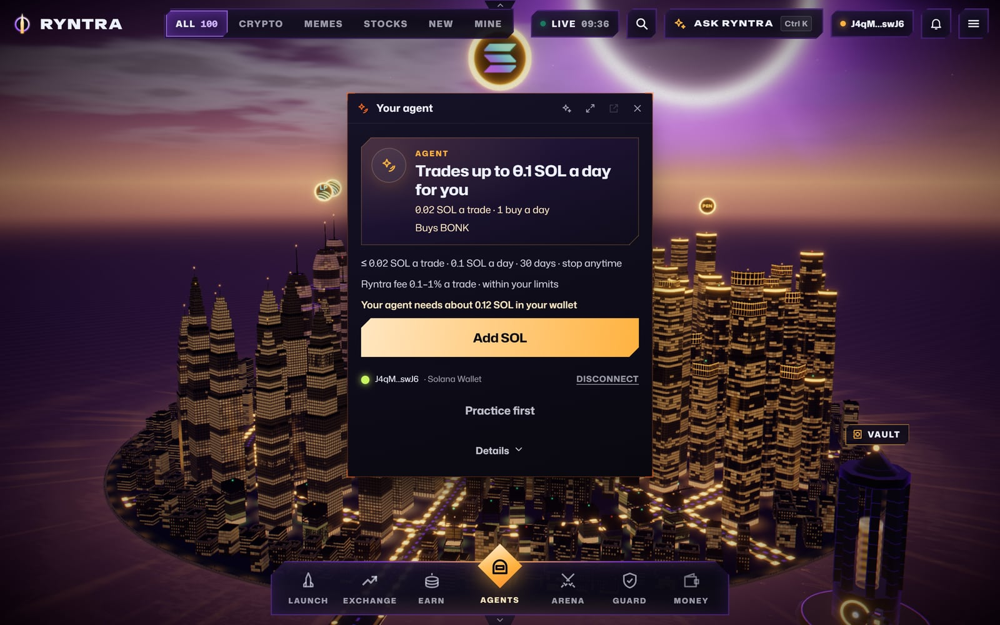
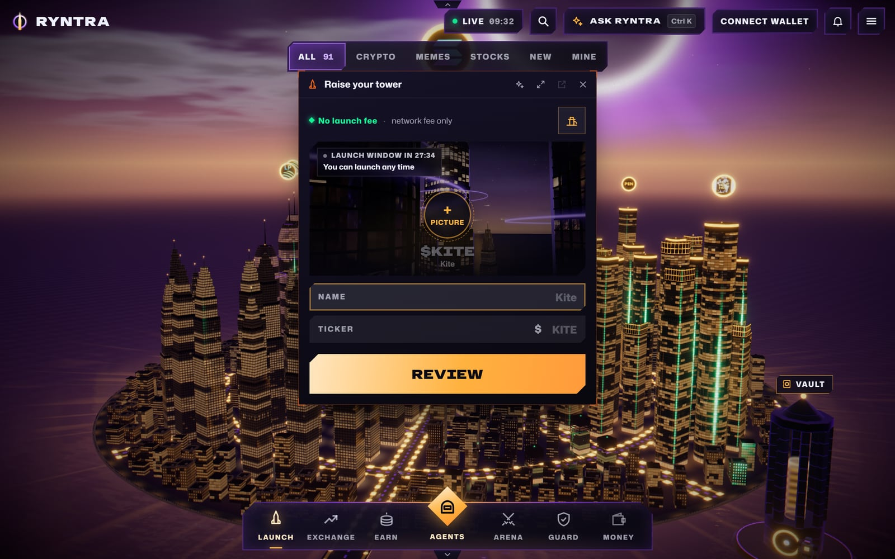
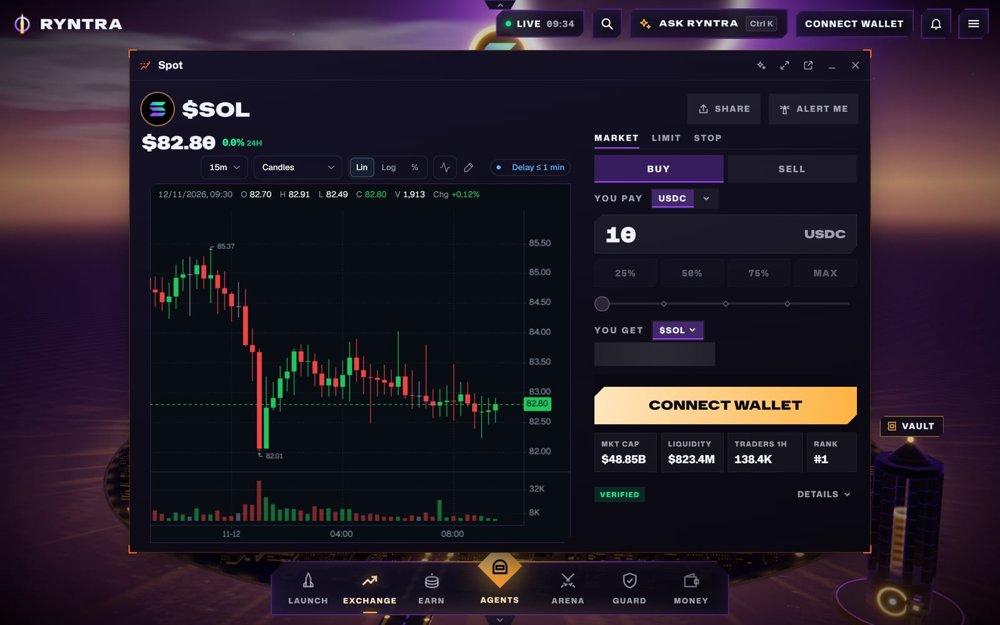
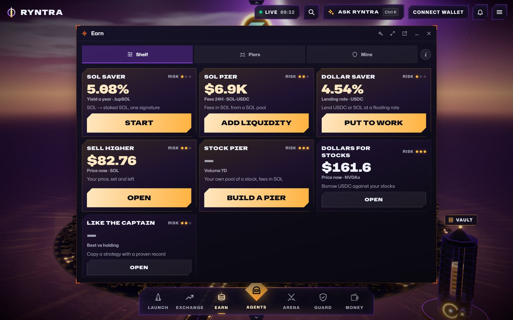
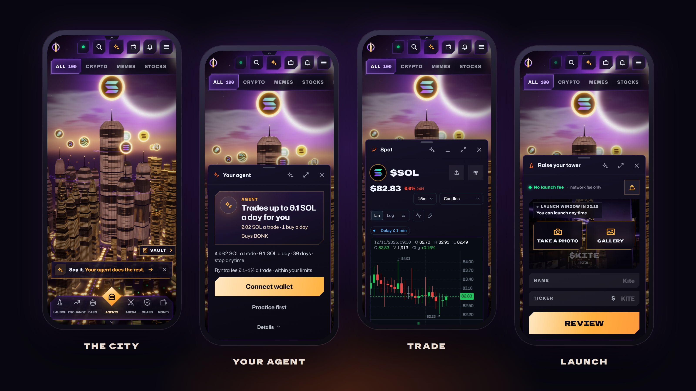
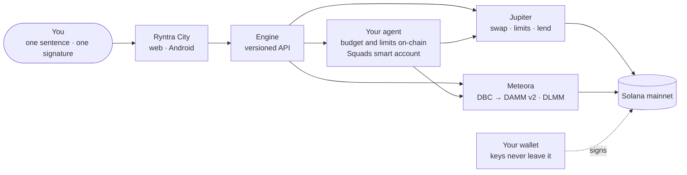

<p align="center">
  <a href="https://ryntra.io"></a>
</p>

<p align="center">
  <a href="https://ryntra.io"></a>
  <a href="https://ryntra.io"></a>
  <a href="#on-your-phone"></a>
  <a href="https://x.com/Ryntra_io"></a>
</p>

<p align="center">
  <a href="https://ryntra.io"><b>Open the city</b></a> ·
  <a href="LEARN.md"><b>How it works, A to Z</b></a> ·
  <a href="METEORA.md"><b>Ryntra on Meteora</b></a> ·
  <a href="https://github.com/ryntra-io/ryntra-solana-evidence"><b>Open-source kit</b></a>
</p>

---

Tell your agent what you want — *“launch me a coin”*, *“trade BONK with 0.1 SOL a day”* — sign its budget once in
your own wallet, and it does the work: launches the coin, buys and sells inside your limits, puts idle dollars to work
and reports back every day. Every coin on Solana is a tower in the city, and yours rises live as people buy.

## What runs today

<table>
  <tr>
    <td width="50%" valign="top">
      
      <h4>🤖 Your agent</h4>
      One sentence becomes a plan — steady buys, dips, grids, new launches, take-profit and stop. Practise on paper,
      then sign the budget once; the agent trades by itself and stops when you say.
    </td>
    <td width="50%" valign="top">
      
      <h4>🚀 Launch</h4>
      Name, ticker, picture, one signature. The coin starts on a Meteora bonding curve, its tower rises, and at about
      $75K it graduates into a pool by itself.
    </td>
  </tr>
  <tr>
    <td width="50%" valign="top">
      
      <h4>📈 Trade</h4>
      Tap a tower, buy or sell in one signature — routed through Jupiter, the cost shown before you sign. Limits and
      stops in the same window.
    </td>
    <td width="50%" valign="top">
      
      <h4>💰 Earn</h4>
      Put SOL or dollars to work in one signature — staking, lending, Meteora pools at the Piers. The position stays in
      your wallet.
    </td>
  </tr>
</table>

**Partners** bring people to the city and earn a share of Ryntra's fee, paid weekly in USDC.

Keys stay with you: every transaction is shown and signed in your own wallet, the agent's limits live on-chain, and one
signature stops it.

## On your phone

<p align="center"></p>

The Android app in the **Solana dApp Store** opens the same city full screen and signs through Mobile Wallet Adapter —
Phantom, Solflare or the Seeker's own wallet. The same city runs in any phone browser at [ryntra.io](https://ryntra.io).

## How it fits together



The engine builds every transaction unsigned; you sign it in your wallet. The agent acts only inside the budget you
signed for it, from a key it never sees, and only toward your own wallet.

## Inside this repository

| Path | What lives there |
|---|---|
| [`city/`](city) | Ryntra City — the 3D market (React Three Fiber), its districts, windows and the dock |
| [`app/`](app) | The Next.js app: the pages and the versioned API behind the city and the phone |
| [`lib/`](lib) | The engine — trading and launches, the agent's mandate and strategies, Earn, accounts, payouts |
| [`packages/`](packages) | Libraries with their own interface: the API client the phone uses, the open developer kit |
| [`apps/mobile/`](apps/mobile) | The Android app — Expo and React Native, Mobile Wallet Adapter |
| [`supabase/`](supabase) | The database schema, migration by migration |
| [`public/`](public) | Static assets, the city's models and these pictures |

7,077 files, each test beside the code it tests. Every update of this repository is one commit named for what
shipped; the latest is from 2026-11-12.

**Built with** Next.js 15 · React 19 · TypeScript · Three.js and React Three Fiber · Solana Kit and web3.js · Jupiter ·
Meteora DBC, DAMM v2 and DLMM · Squads · Supabase · Expo and React Native · Vercel.

## Run it

Node >=22 <25, 22.18 or later.

```bash
npm ci
npm run dev          # http://localhost:3000 — Ryntra City
```

<details>
<summary><b>Tests, types and the production build</b></summary>

```bash
npm test             # unit and contract tests
npm run typecheck
npm run lint
npm run build        # the production build
```

The production build checks the types of the whole app in one go; give Node 8 GB for it:
`NODE_OPTIONS=--max-old-space-size=8192 npm run build`.

The app starts with no environment variables. What needs a provider says so on its own screen: trading asks for a
Jupiter API key (`RYNTRA_JUPITER_API_KEY`), accounts for Supabase (`SUPABASE_URL`, `SUPABASE_ANON_KEY`). Put them in
`.env.local`; no secret is ever committed here. A few tests read documents kept outside this repository and report
themselves as skipped.

</details>

<details>
<summary><b>The Android app</b></summary>

Node >=22 <25, JDK 17 and the Android SDK (platform 36, build-tools 36.0.0, NDK 27.1), with `JAVA_HOME` and
`ANDROID_HOME` set.

```bash
cd apps/mobile
npm ci
npm test
npx uniwind generate-artifacts --css ./src/global.css --dts ./src/uniwind-types.d.ts
npm run typecheck
```

With a phone or an emulator connected, `npx expo run:android` builds and installs a development build. A standalone
APK without the release key:

```bash
npm run release:android -- --unsigned --abi=arm64-v8a
```

It lands in `apps/mobile/dist/`; sign it with your own key (`apksigner sign --ks <your.keystore> <apk>`) before
`adb install`.

</details>

## Built during the hackathon

The code as it stood before the hackathon is tagged `pre-hackathon-baseline-2026-09-11` in the development repository (commit `7fc5776f`,
2026-09-11). Since then, for the 7,077 files here:

| New | Changed | Unchanged | Lines |
|:---:|:---:|:---:|:---:|
| 5,353 | 898 | 826 | +1,120,470 / −28,079 |

[BOUNDARY.md](BOUNDARY.md) lists every new and every changed file.

## Learn more

- **[LEARN.md](LEARN.md)** — every feature in plain words, with the files that do it (also at [ryntra.io/learn](https://ryntra.io/learn))
- **[METEORA.md](METEORA.md)** — how Ryntra uses Meteora, file by file
- **[ryntra-solana-evidence](https://github.com/ryntra-io/ryntra-solana-evidence)** — Ryntra's open-source TypeScript kit for Solana tokens (Apache-2.0)
- **[SECURITY.md](SECURITY.md)** — reporting a vulnerability

## Contact

[hello@ryntra.io](mailto:hello@ryntra.io) · [@Ryntra_io on X](https://x.com/Ryntra_io) · [ryntra.io](https://ryntra.io)

## Licence

© 2026 Ryntra. All rights reserved. The source is public so anyone can read and evaluate it — see [LICENSE](LICENSE).
The open-source kit is published separately under Apache-2.0.
